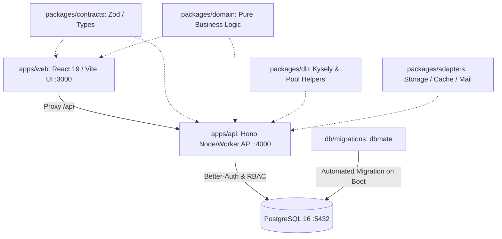

# SP-PLASTECH ERP — Workspace Architecture

## 1. Development Topology



- **`web` (`apps/web`)**: The Vite / React ERP application running on port `3000`.
- **`api` (`apps/api`)**: Hono-based unified API handling Better-Auth, RBAC authorization, and module domain endpoints on port `4000`.
- **`db`**: PostgreSQL 16 database running on port `5432`.
- **`migrate`**: `dbmate` container running idempotent SQL migrations from `db/migrations/`.
- **Vite Proxy**: Forward `/api` requests from Vite (`:3000`) directly to `api` (`:4000`).

---

## 2. Local Podman Stack Commands

```powershell
# Start the full 4-service stack (db, migrate, api, web)
podman compose up --build

# Or via npm script
npm run dev:podman

# Tear down the stack
podman compose down

# Tear down with volume removal (clean slate)
podman compose down -v
```

Health check endpoints:
- Web: `http://localhost:3000`
- API Health & Auth: `http://localhost:4000/api/auth/ok`

---

## 3. Plop Enterprise Module Generator

Every module starts from a tested, working skeleton without copy-paste drift:

```powershell
# Scaffold a new top-level module (contracts, DDL, backend slice, domain golden tests, web module, e2e suite, docs)
npm run gen:module -- <name> <Subject>

# Scaffold a child table / resource inside an existing module
npm run gen:resource -- <module> <name>
```

### Shared Primitives
- **Client**: `src/shared/api/http.ts` (promoted `request`, typed `ApiError`, `one`, `page`).
- **Resource Factories**: `src/shared/api/resource.ts` (`createResourceApi`, `createResourceHooks`).
- **Backend CRUD Router**: `apps/api/src/core/crud.ts` (`createResourceRouter` with OCC, `withTx`, and synchronous `audit_logs`).

