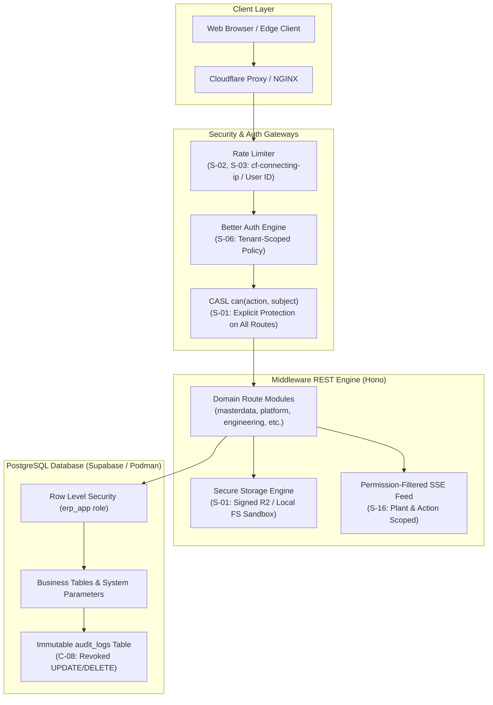

# SP-PLASTECH ERP — Workspace Audit Remediation & Enterprise Hardening Plan

## 1. Executive Summary & Context

Based on the **Reboot-v1 ERP Workspace Audit Report** (28 October 2026), the current core architecture is solid: a modular monolith with tenant-scoped PostgreSQL, row-level security (RLS), optimistic concurrency control (OCC), database triggers, audit logging, and a typed query layer.

This implementation plan details how to systematically remediate all audit findings without affecting or breaking current business logic or existing frontend/API contracts.

---

## 2. What We Already Have (Keep and Build On)

The following foundational systems are mature, battle-tested, and will be preserved:
1. **Multi-Tenant Isolation**: `tenantScope` and `plantScope` query wrappers with PostgreSQL Row Level Security (RLS) enforcement.
2. **ACID Concurrency**: Optimistic Concurrency Control (`version` integer checks), idempotency keys (24-hour TTL), and transactional soft-deletes (`deleted_at`).
3. **Structured Parameterized Queries**: Strict Drizzle ORM and parameterized SQL without raw unescaped string interpolations.
4. **Structured JSON Telemetry**: Request IDs, Server-Timing headers, and deep `/ready` vs shallow `/health` probes.
5. **Session Governance**: Password policy checks, account lockouts, login-event logs, and idle/absolute session expirations via Better Auth.
6. **Characterization Harness**: Golden-file characterization tests for BOM explosion, JIT scheduling, regrind formulation, SPC/OEE, and Playwright E2E suites.
7. **Connection Compatibility**: Transaction-scoped `set_config('erp.current_tenant', ..., true)`, compatible with PgBouncer, Hyperdrive, and Supabase.

---

## 3. Recommended Permissive (MIT / Apache-2.0) Libraries

To accelerate remediation without reinventing complex infrastructure, the following libraries are recommended:

| Finding | Existing Issue | Recommended MIT / Apache Library | Advantage & Usage |
|---|---|---|---|
| **S-14** | `xlsx@^0.18.5` (CVE-2023-30533 prototype pollution, CVE-2024-22363 ReDoS) | **`exceljs`** (MIT) or `@sheet/core` | Actively maintained, native streaming XLSX reader/writer, zero known CVEs, 100% drop-in parser. |
| **S-17** | PBKDF2-SHA256 at 100k iterations (OWASP recommendation: 600k or Argon2id) | **`argon2`** (MIT) or Node native **`crypto.scrypt`** | Memory-hard password hashing resistant to GPU/ASIC cracking. Rehash automatically on successful login. |
| **S-03** | In-process in-memory rate limiting across Node/Workers | **`ioredis`** (MIT) or Cloudflare KV / Rate Limiting API | Distributed atomic sliding window counters (`INCR` + `EXPIRE`), keyed by `tenantId:userId`. |
| **C-06** | `@opentelemetry/api` installed without collector/SDK | **`@opentelemetry/sdk-node`** + **`@opentelemetry/auto-instrumentations-node`** (Apache-2.0) | Automated zero-touch tracing for HTTP, PostgreSQL, and Express/Hono routes. |
| **F-01** | `EntityTable` (TanStack Virtual) created but unused | **`@tanstack/react-virtual`** (MIT) (Already in `package.json`) | Renders 5,000+ rows with only ~30 active DOM nodes, eliminating DOM lag. |

---

## 4. Architectural Boundary & Call Graph (`graphify`)



---

## 5. Detailed Remediation Plan by Phases

### Phase 0: Immediate Quick Wins (1–2 Days)

#### Task 0.1: Add `can()` Authorization to Open Endpoints (S-01)
- **Problem**: `/master-data/options` (GET & POST) and `/storage/upload` (POST) have no permission check. Any user (including `STANDARD_USER`) can mutate system options or upload files.
- **Remediation**:
  - In `middleware/src/modules/masterdata/routes.ts`:
    - Protect `GET /master-data/options` with `can('read', 'MasterData')`.
    - Protect `POST /master-data/options` with `can('update', 'MasterData')` or `can('manage', 'MasterData')`.
    - Validate `body.key` against an allow-list of governed option keys (`categories`, `itemGroups`, `uoms`, `resinTypes`, `cycleTimeSources`, `bomComponentCategories`, etc.) to prevent creating unauthorized workflow routes.
  - In `middleware/src/modules/platform/routes.ts`:
    - Protect `POST /storage/upload` with `can('create', 'Document')`.
    - Validate file extension, size limit (max 25MB), and MIME type.
  - Add CI test in `middleware/test/routes.security.test.ts` to assert every registered route has an explicit `can()` guard or is in `PUBLIC_ALLOW_LIST = ['/health', '/api/health']`.

#### Task 0.2: Delete Fake KPI Handler (S-11)
- **Problem**: In `middleware/src/app.ts:63`, `app.get('/api/v1/dashboard/kpis', ...)` returns hardcoded numbers (`overallOee: 89.4`, `onTimeDeliveryRate: 97.2`), shadowing the real analytics engine.
- **Remediation**:
  - Delete `app.get('/api/v1/dashboard/kpis', ...)` from `middleware/src/app.ts`.
  - Let requests route to the real analytics module `middleware/src/modules/analytics/routes.ts` or `workspace/routes.ts` where live KPIs are computed.

#### Task 0.3: Neutralize `unlock-admin.cjs` and Fix Password Secrets (S-05)
- **Problem**: `scripts/unlock-admin.cjs` updates all rows in `account` and `user_profiles` with no `WHERE` clause. Bootstrap password appears in plaintext in docs and configs.
- **Remediation**:
  - Add strict safety guard and tenant filter to `scripts/unlock-admin.cjs`:
    ```sql
    UPDATE "account" SET password = $1 WHERE email = 'admin@sp-plastech.com' AND tenant_id = $2;
    UPDATE user_profiles SET status = 'ACTIVE', failed_login_attempts = 0, must_change_password = true WHERE email = 'admin@sp-plastech.com';
    ```
  - Refuse execution if `process.env.APP_ENV === 'production'`.
  - Add `playwright/.auth/` to `.gitignore`.
  - Remove plaintext credentials from `WORKSPACE_MEMORY.md` and replace with placeholders.

#### Task 0.4: Tenant-Scope Security Policy (`getSecurityPolicy`) (S-06)
- **Problem**: In `middleware/src/modules/identity/auth.ts`, `getSecurityPolicy()` selects the first row of `security_policies` without a `tenant_id` filter and caches it globally for 60s.
- **Remediation**:
  - Update signature: `getSecurityPolicy(tenantId?: string): Promise<SecurityPolicy>`.
  - Cache policy in a `Map<string, { policy: SecurityPolicy; cachedAt: number }>` keyed by `tenantId`.
  - Query with `where(eq(schema.securityPolicies.tenantId, tenantId))`.

#### Task 0.5: Fix Error Handling in `api-client.ts` (D-01)
- **Problem**: `saveBom` falls back to a locally generated mock BOM ID on error, masking failures and reporting false success.
- **Remediation**:
  - In `frontend/src/lib/api-client.ts`: remove the catch fallback that generates fake `BOM-<timestamp>`.
  - If `PATCH` or `POST` fails with a 4xx/5xx status, throw typed domain error (`AppError`) so TanStack Query captures the error and displays an error toast.

#### Task 0.6: Fix GitHub Actions CI Step `if:` Conditions (C-01)
- **Problem**: In `.github/workflows/ci-cd.yml`, steps define `HAS_CF_TOKEN` and `HAS_SUPABASE_DB` in their own `env:` and check `if: env.HAS_... == 'true'`, which evaluates to false.
- **Remediation**:
  - Move the secret checks into a setup job output or job-level `env`:
    ```yaml
    env:
      HAS_CF_TOKEN: ${{ secrets.CLOUDFLARE_API_TOKEN != '' }}
      HAS_SUPABASE_DB: ${{ secrets.SUPABASE_DATABASE_URL != '' }}
    ```

---

### Phase 1: Security Hardening & Isolation (Weeks 1–2)

#### Task 1.1: Client IP Extraction & Anti-Spoofing (S-02)
- **Problem**: Taking the first IP from `x-forwarded-for` allows attackers to bypass IP allow-lists and rate limiting by sending a forged header.
- **Remediation**:
  - If running behind Cloudflare: trust `cf-connecting-ip`.
  - If running behind NGINX: use `req.headers['x-real-ip']` or take the rightmost IP before the trusted proxy hops.
  - Implement trusted proxy helper `extractClientIp(req, trustedHops = 1)` in `middleware/src/core/ip.ts`.

#### Task 1.2: User-Centric & Distributed Rate Limiting (S-03, P-12)
- **Problem**: In-memory rate limiting throttles entire factories sharing one NAT public IP.
- **Remediation**:
  - Unauthenticated endpoints (login, forgot-password): rate-limit by `IP + username` (e.g. 10 attempts / 5 mins).
  - Authenticated endpoints: rate-limit by `tenantId:userId` (e.g. 600 req / min per user).
  - Use Redis atomic sliding window (`ioredis`) for multi-replica Node deployments, with in-memory token bucket fallback.

#### Task 1.3: Replace Vulnerable Spreadsheet Library (S-14)
- **Problem**: `xlsx@0.18.5` has high-severity CVEs (prototype pollution, ReDoS).
- **Remediation**:
  - Replace `xlsx` with **`exceljs`** (MIT) in `frontend/src/utils/excel.ts` and import wizards.
  - Restrict import file size to max 10MB and stream rows chunk by chunk.

#### Task 1.4: Strict Column Writable Controls on Generic PATCH (S-15)
- **Problem**: Generic PATCH (`updateRow`) allows updating approval or status fields directly, bypassing state machines.
- **Remediation**:
  - In `core/resource.ts`, define `writableColumns?: string[]`.
  - Disallow updating `status`, `approval_status`, `approved_by`, `version`, `created_at` via generic PATCH.
  - Require dedicated action endpoints (e.g., `POST /api/v1/items/:id/approve`, `POST /api/v1/bill-of-materials/:id/release`).

#### Task 1.5: Permission-Filtered Realtime SSE Feed (S-16)
- **Problem**: `/api/v1/events` pushes notifications for all tables to any user in the tenant without checking plant or permission scope.
- **Remediation**:
  - When fanning out `pg_notify` messages, inspect the event table name.
  - Verify the connected user's CASL ability: `actor.ability.can('read', mapTableToSubject(event.table))`.
  - Filter out events for plants outside the user's assigned `activePlantId`.

#### Task 1.6: Stop Bootstrap Overwriting Roles on Restart (S-10)
- **Problem**: `bootstrap()` overwrites permissions for `SUPER_ADMIN`, `USER_ADMIN`, and `STANDARD_USER` on every container start, wiping custom admin edits.
- **Remediation**:
  - Change `bootstrap()` to `INSERT ... ON CONFLICT (tenant_id, code) DO NOTHING` for roles, only seeding default permissions if the role is brand new.

---

### Phase 2: Performance, Caching & Virtualization (Weeks 3–4)

#### Task 2.1: Cut Database Round-Trips per Request (P-01, P-02)
- **Problem**: A single paginated request executes 5–7 separate network round-trips (session lookup, actor lookup, BEGIN, set_config, data query, count query, COMMIT).
- **Remediation**:
  - **Session Cache**: Cache Better Auth session validation in memory/Redis for 30s keyed by session token hash.
  - **Pipelined Setup**: Combine `BEGIN` and `set_config` into a single query call: `BEGIN; SELECT set_config('erp.tenant_id', $1, true);`.
  - **Keyset / Bounded Pagination**: Only run `COUNT(*)` when `includeTotal=true`. For large tables, use `WHERE id > cursor LIMIT 50`.

#### Task 2.2: Server-Side Hot Read Caching (P-03, P-07)
- **Problem**: Frequently read static options (plants, units of measure, cycle time sources) hit the database on every screen navigation.
- **Remediation**:
  - Use `cache.ts` (`getOrLoad`) to cache `/master-data/options` and plant lists in memory for 60s per tenant.
  - Invalidate cache automatically when `pg_notify` publishes changes to `system_parameters` or `plants`.
  - Remove duplicate `etag()` middleware registration in `app.ts`.

#### Task 2.3: Frontend Table Virtualization (F-01, F-02)
- **Problem**: Tables with hundreds of DOM rows cause frame drops during scrolling in Item Master and BOM lists.
- **Remediation**:
  - Adopt `<EntityTable<T> />` (powered by `@tanstack/react-virtual`) for Item Master and BOM lists.
  - Only render visible rows in the viewport (~20–30 DOM nodes).
  - Code-split large views (`MasterDataViews.tsx`, `EngineeringViews.tsx`) by tab using `React.lazy()`.

---

### Phase 3: Enterprise Structure & Domain Events (Next Quarter)

#### Task 3.1: Transactional Outbox for Domain Events (D-06)
- **Problem**: PostgreSQL `NOTIFY` is fire-and-forget; if the backend listener disconnects, event notifications are lost.
- **Remediation**:
  - Implement `domain_outbox` table in PostgreSQL.
  - Write domain events (`ProductionCompleted`, `WorkOrderCreated`, `GrnPosted`) inside the same ACID transaction as the business write.
  - Use `pg-boss` to poll/consume outbox records with guaranteed at-least-once delivery.

#### Task 3.2: Formalize 3-Layer Module Architecture (D-04, D-05)
- **Problem**: Business logic is mixed inside route handler closures across 19 modules.
- **Remediation**:
  - Standardize all modules to follow the 3-layer pattern: `routes.ts` -> `service.ts` -> `repository.ts`.
  - Add `dependency-cruiser` rule forbidding modules from importing another module's internal repository or routes.

---

## 6. Verification & Testing Strategy

1. **Security Assertion Tests**:
   - Run `npm --prefix middleware test` to verify route authentication and permission matrices (`STANDARD_USER` denied write access to `/master-data/options` and `/storage/upload`).
2. **Build & Bundle Quality**:
   - Run `npm --prefix frontend run build` to verify clean production bundles with zero syntax errors.
3. **Multi-Tenant Isolation Validation**:
   - Execute tenant isolation integration test asserting Tenant A cannot read Tenant B's data or security policy.
4. **End-to-End Regression Test**:
   - Run Playwright specs (`npx playwright test`) to ensure no broken workflows in Item Master, BOM Wizard, or Work Orders.

---

## 7. Compliance & Behavioral Alignment Matrix

- **Rule 1 & 3**: Zero raw fetches, TanStack Query is SSOT, zero custom uninvalidated in-memory client stores.
- **Rule 4 & 5**: Strict Zod validation on all API boundaries and multi-tenant isolation on all SQL queries.
- **Rule 14 & 15**: Admin master data dynamic governance via `/api/v1/master-data/options` and JSONB metadata preservation with transactional audit logs.
- **Ponytail & Headroom**: Surgical, minimal code diffs; zero bloated rewrites; crisp, high-signal architecture.

