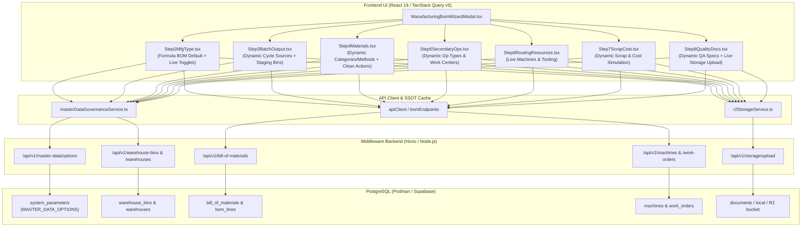

# SP-PLASTECH ERP — BOM Wizard Dynamic API Migration & Architecture Implementation Plan

## 1. Executive Summary & Architecture Blueprint

### 1.1 Objective
Eliminate all static mock data, hardcoded fallback arrays, and broken UI layouts from the 9-step Manufacturing BOM Wizard. Replace them with high-performance, single-round-trip REST API calls (`/api/v1/...`) backed by PostgreSQL, TanStack Query v5 cache as SSOT, and Admin Master Data Governance (`/api/v1/master-data/options`), matching the architectural pattern established in Item Master.

### 1.2 System Boundary & Call Graph (`graphify`)


---

## 2. Detailed Task Breakdown & Implementation Specifications

### Task-1: Default Architecture, Execution Toggles, Dynamic Sources & Modal Dropdowns

#### 1.1 Formula / Recipe BOM as Default
- **Files Modified**: 
  - [`ManufacturingBomWizardModal.tsx`](file:///c:/Users/charu/Reboot-v1/frontend/apps/web/src/modules/engineering/components/bomWizard/ManufacturingBomWizardModal.tsx)
  - [`Step2MfgType.tsx`](file:///c:/Users/charu/Reboot-v1/frontend/apps/web/src/modules/engineering/components/bomWizard/Step2MfgType.tsx)
- **Changes**:
  - In `buildInitialState()`, change `mfgCategory` from `'Discrete Manufacturing BOM'` to `'Formula / Recipe BOM'`.
  - In `Step2MfgType.tsx`, update recommendation logic so `Formula / Recipe BOM` displays as the primary recommended architecture for polymer compounding, masterbatch dosing, and plastic molding recipes.

#### 1.2 Manufacturing Execution & Control Toggles Live End-to-End
- **Toggles**:
  1. `multiLevelEnabled`: Enables sub-assembly nesting and multi-level explosion during MRP runs.
  2. `allowSubstitutes`: Flags whether production order material reservation accepts alternate resin grades.
  3. `allowRegrind`: Controls whether regrind dosing is accepted and scrap credit is applied in production journals.
  4. `requireQualityInspection`: When active, production orders require mandatory QA hold / FAI sign-off before stock moves to FG.
  5. `requireCustomerApproval`: Locks BOM state to `pending_customer_approval` until OEM sign-off.
  6. `autoCreateSecondaryWO`: When enabled, whenever a primary injection molding Work Order is created or completed for this BOM, downstream trimming/packaging work order creation is automatically triggered and linked (`code: WO-SEC-<ParentCode>`).
- **Persistence Strategy (Rule 15)**:
  - Stored inside `lines._bomMeta.executionToggles`:
    ```json
    {
      "multiLevelEnabled": true,
      "allowSubstitutes": true,
      "allowRegrind": true,
      "requireQualityInspection": true,
      "requireCustomerApproval": false,
      "autoCreateSecondaryWO": true
    }
    ```
  - Backend integration in `middleware/src/modules/manufacturing/routes.ts`:
    - When `POST /work-orders` or `POST /production_entries` is called, check if the BOM has `autoCreateSecondaryWO: true`. If true, automatically insert linked secondary work order into `work_orders` table within the same transaction.

#### 1.3 Dynamic Cycle Time Source via API
- **Endpoint**: `GET /api/v1/master-data/options` (key: `cycleTimeSources`) and `POST /api/v1/master-data/options`.
- **Default Seed**: `['Item Master', 'Routing', 'Machine/Mold Specific', 'Manual Estimate']`.
- **UI in `Step3BatchOutput.tsx`**:
  - Replace static radio/select list with dynamic query `useMasterDataOptions('cycleTimeSources')`.
  - Provide `+ Add Source` inline modal for Admin to add custom cycle time estimation methods on the fly, immediately persisted to PostgreSQL.

#### 1.4 Dynamic Warehouse Staging Location Codes (Master Data Autocomplete)
- **Input Fields**:
  - Input Raw Material Bin (`defaultInputLocation`)
  - Default WIP Buffer Bin (`defaultWipLocation`)
  - Finished Goods Putaway (`defaultFgLocation`)
  - Secondary Operation Bin (`defaultSecondaryLocation`)
- **Endpoints**: `GET /api/v1/warehouse-bins`, `GET /api/v1/warehouses`, `POST /api/v1/warehouse-bins`.
- **Changes in `Step3BatchOutput.tsx` & `LocationAutocompleteInput.tsx`**:
  - Remove all in-memory static arrays (`RM-SILO-01`, `WIP-STAGE-01`, etc.).
  - Fetch bins directly from `GET /api/v1/warehouse-bins` with TanStack Query.
  - In `handleSaveLocation()`, execute `POST /api/v1/warehouse-bins` (payload: `{ warehouseId, binCode, zone, capacityKg }`), invalidating `queryKeys.warehouse.bins` for 0ms direct UI updates.

#### 1.5 Add Component Modal Dropdown Fields Dynamic via API
- **Modal in `Step4Materials.tsx`**:
  - `Component Category`: Fetch from `GET /api/v1/master-data/options` (key: `bomComponentCategories`), with default seed `['Virgin Resin', 'Color Masterbatch', 'Additive / Stabilizer', 'Regrind Polymer', 'Metal Insert', 'Label / Decal', 'Corrugated Shipper', 'Packaging Consumable']`.
  - `Issue Method`: Fetch from `GET /api/v1/master-data/options` (key: `bomIssueMethods`), with default seed `['Auto Backflush (Post-run)', 'Manual Kitting / Picking', 'Lot Traceable Pick', 'Bulk Pre-stage']`.
  - `Source Location`: Dynamic bin picker consuming `GET /api/v1/warehouse-bins`.
  - Admin quick-add button `+ New` on each field to create new categories and issue methods live.

---

### Task-2: Fix Broken Actions UI in BOM Component Table

- **Problem Diagnosis** (Screenshot 4: `media_1793164132057_cb8e5c8b.png`):
  - In `Step4Materials.tsx`, table has `table-auto` inside an `overflow-visible` div.
  - Column 13 ("ACTIONS") has `w-24` (96px). It houses 5 distinct action buttons (`ArrowUp`, `ArrowDown`, `Edit2`, `Copy`, `Trash2`).
  - Due to variable widths of the `Location` picker and `Description` columns, the Actions column shrinks below 70px, wrapping icons, truncating buttons, and causing misaligned table rows.
- **Solution & Code Changes**:
  1. Wrap table in `<div className="w-full overflow-x-auto rounded-xl border border-[#E4E0D6] shadow-xs bg-white">` with a minimum width `min-w-[1100px]`.
  2. Increase Actions header to `w-36 min-w-[140px] text-center`.
  3. Format the action buttons into a clean flex container:
     ```tsx
     <td className="py-2.5 px-2 text-center whitespace-nowrap">
       <div className="flex items-center justify-center gap-1">
         <button className="p-1.5 rounded-md text-gray-500 hover:text-slate-800 hover:bg-gray-100 disabled:opacity-20" title="Move Up"><ArrowUp className="w-3.5 h-3.5" /></button>
         <button className="p-1.5 rounded-md text-gray-500 hover:text-slate-800 hover:bg-gray-100 disabled:opacity-20" title="Move Down"><ArrowDown className="w-3.5 h-3.5" /></button>
         <button className="p-1.5 rounded-md text-[#0F8B8D] hover:bg-teal-50" title="Edit Component Details"><Edit2 className="w-3.5 h-3.5" /></button>
         <button className="p-1.5 rounded-md text-blue-600 hover:bg-blue-50" title="Duplicate Row"><Copy className="w-3.5 h-3.5" /></button>
         <button className="p-1.5 rounded-md text-rose-500 hover:text-rose-700 hover:bg-rose-50" title="Delete Row"><Trash2 className="w-3.5 h-3.5" /></button>
       </div>
     </td>
     ```
  4. Explicitly assign fixed percentages or `min-w` to all other columns (`Category: 110px`, `Qty: 75px`, `UOM: 55px`, `Qty/Batch: 90px`, `Scrap: 75px`, `Regrind: 75px`, `Issue Method: 130px`, `Location: 150px`).

---

### Task-3: Configure Secondary Operation Screen Fully Dynamic

- **File**: [`Step5SecondaryOps.tsx`](file:///c:/Users/charu/Reboot-v1/frontend/apps/web/src/modules/engineering/components/bomWizard/Step5SecondaryOps.tsx)
- **Eliminate Static Arrays**:
  - Remove hardcoded `OPERATION_TYPES = ['Trimming', 'Degating', ...]`.
  - Remove hardcoded work centers, locations, and inventory impact strings.
- **Dynamic Endpoints**:
  - `operationTypes`: `GET /api/v1/master-data/options` (key: `secondaryOperationTypes`).
  - `workCenters`: `GET /api/v1/master-data/options` (key: `secondaryWorkCenters`) or `GET /api/v1/machines`.
  - `stockStatuses`: `GET /api/v1/master-data/options` (key: `secondaryStockStatuses`).
  - `inventoryImpacts`: `GET /api/v1/master-data/options` (key: `secondaryInventoryImpacts`).
  - `locations`: `GET /api/v1/warehouse-bins`.
- **Admin Dynamic Fields Population**:
  - Add `+ Add Custom Operation Type` and `+ Add Work Center` modal triggers.
  - When an Admin creates an operation type, work center, or location, it executes a `POST` to `/api/v1/master-data/options` or `/api/v1/warehouse-bins`, revalidating the query and immediately appearing in the select dropdowns.

---

### Task-4: Complete Removal of Dummy & Static Arrays across Entire BOM Wizard

- **Audit & Remediation Table**:

| Step | Old Static Data | Replacement Dynamic API Endpoint |
|---|---|---|
| **Step 1 (Basic Info)** | Hardcoded plants (`PLANT-01`), owners | `GET /api/v1/plants` & `GET /api/v1/master-data/options?key=bomOwners` |
| **Step 2 (Mfg Type)** | Hardcoded category strings | Live recommendation engine based on `parentItem` classification + dynamic execution toggles |
| **Step 3 (Batch & Output)** | Static bin list, hardcoded cycle time sources | `GET /api/v1/warehouse-bins` & `GET /api/v1/master-data/options?key=cycleTimeSources` |
| **Step 4 (Materials)** | Static component categories, issue methods | `GET /api/v1/items?approval=approved`, `GET /api/v1/master-data/options?key=bomComponentCategories` |
| **Step 5 (Secondary Ops)**| Static operation list, static cells | `GET /api/v1/master-data/options?key=secondaryOperationTypes` & `GET /api/v1/warehouse-bins` |
| **Step 6 (Routing)** | Static machines, molds, crew skills | `GET /api/v1/machines`, `GET /api/v1/master-data/options?key=molds`, `key=laborSkillLevels` |
| **Step 7 (Scrap & Cost)** | Static scrap categories, static pricing tiers | `GET /api/v1/master-data/options?key=runnerScrapCategories`, `key=materialPriceSources` |
| **Step 8 (Quality & Docs)**| Hardcoded quality parameters, mock docs | `GET /api/v1/master-data/options?key=qualityCriticalParams`, live storage upload |
| **Step 9 (Review & Save)**| Local in-memory state only | Real transactional `POST /api/v1/bill-of-materials` with `_bomMeta` JSONB payload |

---

### Task-5: Dynamic Routing, Scrap Categories, Cost Rollup & Quality Specs

#### 5.1 Step 6 (Routing Resources & Tooling)
- `Step6RoutingResources.tsx`:
  - Machine list: query `GET /api/v1/machines` (filtering active machines, brand, tonnage, hourly rate).
  - Mold list: query `GET /api/v1/master-data/options` (key: `molds`), populated from mold tooling master.
  - Work Centers: query `GET /api/v1/master-data/options` (key: `workCenters`).
  - Labor Skill Levels: query `GET /api/v1/master-data/options` (key: `laborSkillLevels`).
  - Inline modal for creating new work center or machine calls backend API and updates the cache.

#### 5.2 Step 7 (Scrap Categories & Regrind Recovery Parameters)
- `Step7ScrapCost.tsx`:
  - Runner scrap categories: `GET /api/v1/master-data/options` (key: `runnerScrapCategories`).
  - Purge lumps categories: `GET /api/v1/master-data/options` (key: `purgeLumpsCategories`).
  - Pricing source: `GET /api/v1/master-data/options` (key: `materialPriceSources`).
  - Cost simulation rollup uses real hourly rates from selected machine (`hourly_rate` from `/api/v1/machines`) and labor rates from `system_parameters`.

#### 5.3 Step 8 (Quality Specifications & Critical Parameters)
- `Step8QualityDocs.tsx`:
  - Quality critical parameters: `GET /api/v1/master-data/options` (key: `qualityCriticalParams`).
  - Document categories: `GET /api/v1/master-data/options` (key: `bomDocumentTypes`).
  - Admin can add new parameters (e.g., "Wall Thickness Tolerance ±0.02mm") and document categories dynamically.

---

### Task-6: Live Engineering Documents & Drawings (Local + Cloud R2)

#### 6.1 Storage Backend Endpoint
- **Endpoint**: `POST /api/v1/storage/upload`
  - Accepts multipart/form-data or JSON payload `{ fileName, fileType, fileData, category: 'engineering_drawings' }`.
  - **Local Mode (Default)**: Writes file to `.storage/uploads/engineering/` and returns `{ url: '/api/v1/storage/files/:fileId', fileId, fileName, size, mimeType }`.
  - **Cloud Mode (Cloudflare R2)**: If R2 environment variables are configured (`R2_ACCOUNT_ID`, `R2_ACCESS_KEY_ID`, `R2_SECRET_ACCESS_KEY`, `R2_BUCKET`), streams directly to R2 bucket and returns `{ url: 'https://documents.sp-plastech.com/engineering/...', fileId, ... }`.
  - **Retrieval**: `GET /api/v1/storage/files/:fileId` serves the stored file with proper MIME headers and `Content-Disposition`.

#### 6.2 Frontend Live Upload Integration in `Step8QualityDocs.tsx`
- Replace `URL.createObjectURL(file)` with async `uploadFile` mutation:
  ```ts
  const uploadMutation = useMutation({
    mutationFn: async (file: File) => {
      const formData = new FormData();
      formData.append('file', file);
      formData.append('category', 'engineering_drawings');
      const res = await api.post('/storage/upload', formData, {
        headers: { 'Content-Type': 'multipart/form-data' },
      });
      return res.data;
    },
    onSuccess: (uploadedDoc) => {
      // Append persistent document record to wizard state
    }
  });
  ```
- Each attached document in the table displays:
  - File Name, Type, Version, File Size, Uploaded Timestamp.
  - **Live Preview button**: Opens preview modal / new tab with real URL.
  - **Download button**: Triggers direct file download.
  - **Delete button**: Removes document from BOM state.

---

## 3. Execution Plan & Phased Roadmap

| Phase | Tasks Covered | Deliverables | Verification Criteria |
|---|---|---|---|
| **Phase 1** | Task-1 & Task-2 | - Set `Formula / Recipe BOM` default.<br>- Wire live execution toggles into `_bomMeta`.<br>- Fix Actions column CSS and table overflow in `Step4Materials.tsx`.<br>- Dynamic cycle time source and warehouse bins in `Step3BatchOutput.tsx`. | Modal opens with Formula BOM selected; Actions column buttons are perfectly aligned; Bins and Cycle Sources fetch from API. |
| **Phase 2** | Task-3 & Task-4 | - Migrate `Step5SecondaryOps.tsx` to dynamic options via `/master-data/options`.<br>- Scrub all static arrays across Steps 1–5.<br>- Add admin creation modals for operation types and work centers. | All dropdowns populate from database; Admin can create new operation types live. |
| **Phase 3** | Task-5 | - Migrate `Step6RoutingResources.tsx` to live `/machines` and `/master-data/options`.<br>- Migrate `Step7ScrapCost.tsx` scrap categories and pricing sources.<br>- Migrate `Step8QualityDocs.tsx` quality specs. | Zero hardcoded arrays in routing, scrap, or quality; options sync across browser sessions. |
| **Phase 4** | Task-6 & Backend | - Implement `POST /api/v1/storage/upload` and `GET /api/v1/storage/files/:fileId`.<br>- Wire file upload in `Step8QualityDocs.tsx`.<br>- End-to-end work order auto-creation for `autoCreateSecondaryWO`. | Real files uploaded from disk persist, view, and download; BOM releases with full metadata to PostgreSQL. |
| **Phase 5** | Verification & Polish | - Full monorepo build check (`npm run build`).<br>- Browser automated visual audit across all 9 steps.<br>- Git commit and push to `refactor/two-layer`. | 100% build green, zero console warnings, perfect UI in Chrome DevTools. |

---

## 4. Architectural Rules Compliance Matrix

- **Rule 1 (TanStack Query SSOT)**: All catalog queries and mutations use `useQuery` / `useMutation`.
- **Rule 2 (Bounded Pagination)**: All item, machine, and bin lookups use bounded `limit: 50-100`.
- **Rule 3 (No Local Storage Caches)**: In-memory arrays eliminated; TanStack Query cache is sole source of truth.
- **Rule 14 (Master Data Governance SSOT)**: Extensible options sync to `system_parameters` via `/master-data/options`.
- **Rule 15 (JSONB Strategy & Audit)**: Complex BOM attributes preserved in `lines._bomMeta` with immutable audit logging.

