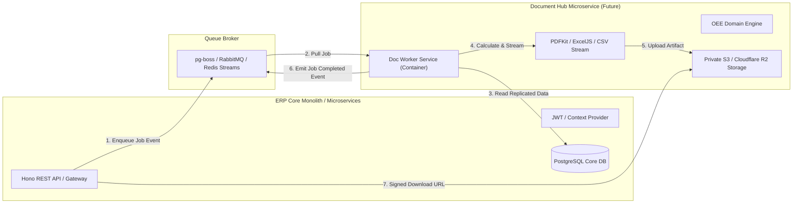
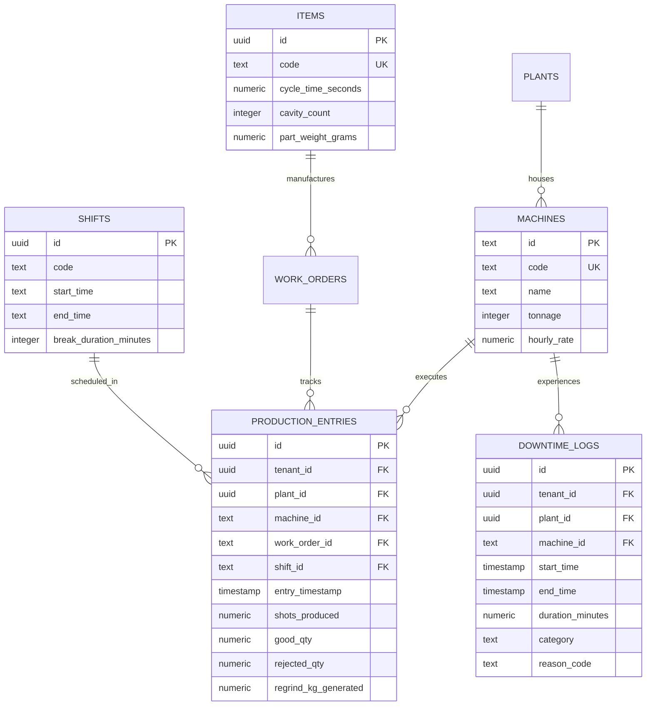
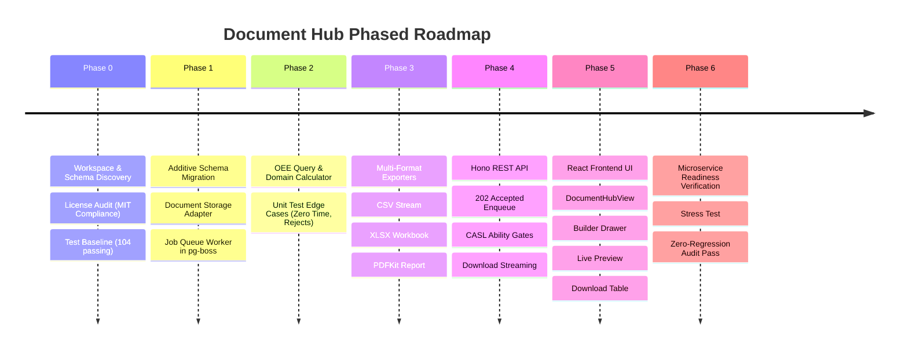

# SP-PLASTECH ERP — Document Hub Enterprise Implementation Plan

**Target Stack:** React 19 + Tailwind CSS, Node.js + Hono, PostgreSQL (Supabase/Podman), Drizzle ORM, TanStack Query v5, Zod, pg-boss  
**Architecture:** Feature-isolated modular monolith with decoupled worker process; 100% microservice-ready extraction path  
**Initial Flagship Report:** Production OEE by Date Range, Plant, Machine, and Shift  
**Export Formats:** PDF, XLSX, and CSV (unified domain calculation engine)  
**Primary Directive:** Zero regression on existing ERP models, APIs, authentication, authorization, and transactional business logic.

---

## 1. Executive Discovery & Gap Analysis

### 1.1 What Is Already in the Workspace (Reusable Assets)

| Category | Existing Workspace Capability | File / Location | Status |
|---|---|---|---|
| **ORM & Database** | PostgreSQL via Drizzle ORM (`drizzle-orm: ^0.45.4`) with transaction runner `withDrizzleTx` | `middleware/src/db.ts`, `middleware/src/schema/` | **Ready** |
| **Background Queue** | `pg-boss: ^12.38.0` queue processor with worker registration, error events, and job lifecycle | `middleware/src/jobs/index.ts` | **Ready** |
| **Production Schema** | `production_entries` (shots, goodQty, rejectedQty, operatorId, timestamp) | `middleware/src/schema/erp.ts:397` | **Ready** |
| **Downtime Schema** | `downtime_logs` (machineId, startTime, endTime, durationMinutes, category, reasonCode) | `middleware/src/schema/erp.ts:419` | **Ready** |
| **Equipment Schema** | `machines` (id, code, name, tonnage, plant, hourlyRate, status) | `middleware/src/schema/erp.ts:116` | **Ready** |
| **Shift Calendar** | `shifts` (id, code, name, startTime, endTime, breakDurationMinutes, isNightShift) | `middleware/src/schema/identity.ts:283` | **Ready** |
| **Item Master Metrics** | `items` (cycleTimeSeconds, cavityCount, partWeightGrams, runnerWeightGrams) | `middleware/src/schema/erp.ts:26` | **Ready** |
| **Work Orders** | `work_orders` (id, code, itemCode, machineId, targetQty, producedQty) | `middleware/src/schema/erp.ts:174` | **Ready** |
| **Multi-Tenant Auth** | Session-authoritative `/api/v1/me`, RLS `tenant_id` context, plant scoping | `middleware/src/middleware/auth.ts` | **Ready** |
| **CASL Ability Gate** | `@casl/ability` RBAC policy engine (`can('read', 'DocumentHub')`) | `middleware/src/ability.ts`, `frontend/src/features/identity/ability.ts` | **Ready** |
| **Audit Logging** | Immutable `audit_logs` transactional event stream | `middleware/src/schema/erp.ts:261`, `middleware/src/db/audit.ts` | **Ready** |
| **Spreadsheet Lib** | `xlsx: ^0.18.5` installed in workspace | `package.json:59`, `frontend/package.json:52` | **Ready** |
| **UI Primitives** | Generic `EntityTable`, `EntityDrawer`, badges, Lucide icons, Tailwind tokens | `frontend/src/shared/components/`, `components/ui/` | **Ready** |

---

### 1.2 What Needs to Be Added (New Feature-Isolated Artifacts)

| Component | Target Location | Description |
|---|---|---|
| **Document Hub Schema** | `middleware/src/schema/documentHub.ts` | Additive tables: `document_report_jobs` (job queue tracking) & `generated_documents` (file metadata). |
| **Document Storage Adapter** | `middleware/src/storage/documentStorage.ts` | Decoupled private storage interface: local private storage directory now, S3 / Cloudflare R2 bucket in microservice future. |
| **OEE Calculation Engine** | `middleware/src/modules/document-hub/reports/oeeCalculator.ts` | Shared, deterministic mathematical domain service calculating Availability, Performance, Quality, and OEE. |
| **Multi-Format Exporters** | `middleware/src/modules/document-hub/exporters/` | Unified CSV (streaming), XLSX (multi-sheet workbook), and PDF (`pdfkit`) exporters consuming the same calculation service. |
| **Asynchronous Job Worker** | `middleware/src/jobs/documentWorker.ts` | `pg-boss` worker listening on `report-job-process` queue with concurrency limit, retry backoff, and progress emission. |
| **Hono REST Routes** | `middleware/src/modules/document-hub/routes.ts` | Endpoints: `GET /catalog`, `POST /jobs` (202 Accepted), `GET /jobs`, `GET /jobs/:id`, `GET /preview`, `GET /download/:id`. |
| **Frontend UI Module** | `frontend/apps/web/src/modules/document-hub/` | Professional Document Hub screen: Report Catalog, Builder/Filters drawer, Interactive Preview table, Job status & Download Center. |

---

## 2. API Pattern Analysis: Which API Call Is Best for Document Generation?

### 2.1 The Two API Paradigms

```mermaid
flowchart TD
    subgraph AntiPattern["Synchronous Inline API (ANTI-PATTERN)"]
        Req1["POST /reports/export (Client)"] --> Handler["Hono Request Handler"]
        Handler --> HeavyDB["Long SQL Query (5-30s)"]
        HeavyDB --> Memory["Accumulate All Rows in RAM"]
        Memory --> GenDoc["Generate Heavy PDF / Excel"]
        GenDoc --> Res1["Return Byte Stream (60s+)"]
        Res1 -.-> Timeout["Cloudflare 524 Timeout / RAM Crash / Node Event Loop Starvation"]
    end

    subgraph BestPractice["Asynchronous Job-Based API (RECOMMENDED ENTERPRISE PATTERN)"]
        Req2["POST /api/v1/document-hub/jobs"] --> Validate["Validate Input + Tenant Scope"]
        Validate --> Enqueue["Insert Job (QUEUED) & Enqueue to pg-boss"]
        Enqueue --> FastRes["202 Accepted { jobId, status: 'QUEUED' } ( < 50ms )"]
        
        Enqueue -.-> Worker["Dedicated Worker Process"]
        Worker --> StreamDB["Stream Bounded Rows from DB"]
        StreamDB --> Calc["Shared OEE Domain Engine"]
        Calc --> StreamExport["Stream to Private Storage (PDF/XLSX/CSV)"]
        StreamExport --> Done["Update Job Status -> COMPLETED"]
        
        ClientPoll["Poll / SSE: GET /jobs/:id"] --> Ready["Status: COMPLETED { fileSize, expiresAt }"]
        Ready --> Download["GET /documents/:id/download (Streams File / Signed URL)"]
    end
```



### 2.2 Why Asynchronous Job Pattern (`POST -> 202 Accepted` + Polling/SSE + Streaming Download) Is Best:

1. **Zero Edge Timeout Risk**: Cloudflare Pages / Edge proxies terminate connections taking longer than 100 seconds (`524 Gateway Timeout`). Returning `202 Accepted` in `<50ms` eliminates timeout failures on large queries.
2. **Event Loop Non-Blocking**: Generating multi-page PDFs or 50,000-row workbooks in a synchronous Node.js/Hono request handler blocks the V8 single thread, causing API latency spikes for all other users. Worker isolation keeps the REST API fast.
3. **Resilience & Safe Retries**: Network interruptions on factory floor RF terminals or desktop browsers do not abort the generation job. Once queued, the report finishes in the background and remains available in the Download Center.
4. **Instant Lightweight Preview**: For interactive UI inspection, a separate bounded preview endpoint (`GET /api/v1/document-hub/preview?limit=50`) executes in `<150ms` using server-side pagination, while full exports run asynchronously in the worker.
5. **Direct Microservice Extraction Path**: In the future, the worker process moves into its own Docker container/service reading from the same queue broker without altering the client API contract.

---

## 3. Architecture & Microservice Evolution Strategy

### 3.1 Phase 1: In-Monolith Feature-Isolated Boundary (Today)
- **Shared Codebase**: Clean module directory `middleware/src/modules/document-hub/`.
- **Database Boundary**: Document Hub tables have foreign keys to core entities with explicit `ON DELETE SET NULL` or `RESTRICT`.
- **Worker Execution**: Worker runs in the background using `pg-boss` (PostgreSQL-backed queue already present in the workspace).
- **Storage Interface**: Abstract `DocumentStorage` interface with local filesystem implementation (`/storage/documents/`).

### 3.2 Phase 2: Autonomous Microservice Extraction Path (Future)



### Decoupling Rules to Ensure Effortless Microservice Extraction:
1. **Zero Cross-Module State Mutation**: Document Hub never mutates production records (`work_orders`, `production_entries`, `machines`). It is strictly read-only on business domains.
2. **Strict Contract Boundaries**: Input and output structures are validated with Zod schemas (`ReportJobRequestSchema`, `ReportJobStatusSchema`).
3. **Pluggable Storage Provider**: The document writer depends strictly on an interface `DocumentStorageAdapter` (`saveFile(key, stream, metadata)` / `getDownloadStream(key)`). Transitioning from local disk to AWS S3 or Cloudflare R2 requires changing one environment configuration line (`STORAGE_PROVIDER=r2`).

---

## 4. Production OEE Domain Engine & Mathematical Specification

### 4.1 Enterprise Manufacturing Formulas
The standard ISO 22400 / SEMI E10 plastic injection molding OEE calculation is implemented as a pure, deterministic domain service:

$$\text{Availability} = \frac{\text{Operating Time}}{\text{Planned Production Time}} = \frac{\text{Planned Time} - \text{Unplanned Downtime}}{\text{Shift Duration} - \text{Planned Breaks}}$$

$$\text{Performance} = \frac{\text{Ideal Cycle Time} \times \text{Total Shots/Pieces Produced}}{\text{Operating Time (Seconds)}}$$

$$\text{Quality} = \frac{\text{Good Quantity Produced}}{\text{Total Quantity Produced}} = \frac{\text{Total Quantity} - \text{Rejections}}{\text{Total Quantity}}$$

$$\text{OEE} = \text{Availability} \times \text{Performance} \times \text{Quality}$$

### 4.2 Database Mapping for OEE Inputs



### 4.3 Handling Edge Cases & Division by Zero:
- **Zero Operating Time**: If a machine was completely down for the entire shift, `Availability = 0%`, `Performance = N/A`, `Quality = N/A`, and `OEE = 0%`.
- **Zero Rejections**: If `totalQty > 0` and `rejectedQty = 0`, `Quality = 100%`.
- **Missing Ideal Cycle Time**: If `cycle_time_seconds` on Item Master is `0` or null, fall back to standard rated cycle time based on machine tonnage and document the calculation basis in the report metadata.
- **Overlapping Downtime**: Intervals are merged before summing `durationMinutes` to prevent false negative operating times.

---

## 5. Additive Database Schema (`middleware/src/schema/documentHub.ts`)

Only genuinely missing job-tracking metadata tables will be added via Drizzle migration. Existing tables (`production_entries`, `downtime_logs`, `machines`, `shifts`, `tenants`, `plants`, `user`) remain untouched.

```typescript
import { pgTable, text, timestamp, uuid, integer, numeric, jsonb, boolean } from 'drizzle-orm/pg-core';
import { tenants, plants, user } from './identity.js';

export const documentReportJobs = pgTable('document_report_jobs', {
  id: uuid('id').primaryKey().defaultRandom(),
  tenantId: uuid('tenant_id').notNull().references(() => tenants.id, { onDelete: 'cascade' }),
  plantId: uuid('plant_id').references(() => plants.id, { onDelete: 'set null' }),
  requestedByUserId: text('requested_by_user_id').notNull().references(() => user.id, { onDelete: 'cascade' }),
  reportType: text('report_type').notNull(), // 'PRODUCTION_OEE', 'MACHINE_DOWNTIME', etc.
  reportVersion: integer('report_version').notNull().default(1),
  status: text('status').notNull().default('QUEUED'), // 'QUEUED' | 'PROCESSING' | 'COMPLETED' | 'FAILED' | 'CANCELLED'
  outputFormat: text('output_format').notNull(), // 'PDF' | 'XLSX' | 'CSV'
  filtersJson: jsonb('filters_json').notNull(), // validated dateRange, plantId, machineIds, shiftIds, groupBy
  optionsJson: jsonb('options_json').default({}), // includeDowntimeDetails, includeCharts
  idempotencyKey: text('idempotency_key'),
  queueJobId: text('queue_job_id'),
  attemptCount: integer('attempt_count').notNull().default(0),
  rowCount: integer('row_count').default(0),
  outputBytes: integer('output_bytes').default(0),
  durationMs: integer('duration_ms').default(0),
  errorCode: text('error_code'),
  errorSummary: text('error_summary'),
  expiresAt: timestamp('expires_at', { withTimezone: true, mode: 'date' }),
  createdAt: timestamp('created_at', { withTimezone: true, mode: 'date' }).notNull().defaultNow(),
  startedAt: timestamp('started_at', { withTimezone: true, mode: 'date' }),
  completedAt: timestamp('completed_at', { withTimezone: true, mode: 'date' }),
  updatedAt: timestamp('updated_at', { withTimezone: true, mode: 'date' }).notNull().defaultNow(),
});

export const generatedDocuments = pgTable('generated_documents', {
  id: uuid('id').primaryKey().defaultRandom(),
  tenantId: uuid('tenant_id').notNull().references(() => tenants.id, { onDelete: 'cascade' }),
  jobId: uuid('job_id').notNull().references(() => documentReportJobs.id, { onDelete: 'cascade' }),
  ownerUserId: text('owner_user_id').notNull().references(() => user.id, { onDelete: 'cascade' }),
  storageProvider: text('storage_provider').notNull().default('local'), // 'local' | 's3' | 'r2'
  storageKey: text('storage_key').notNull(),
  fileName: text('file_name').notNull(),
  mimeType: text('mime_type').notNull(),
  outputFormat: text('output_format').notNull(),
  fileSizeBytes: integer('file_size_bytes').notNull().default(0),
  checksumSha256: text('checksum_sha256'),
  downloadCount: integer('download_count').notNull().default(0),
  lastDownloadedAt: timestamp('last_downloaded_at', { withTimezone: true, mode: 'date' }),
  expiresAt: timestamp('expires_at', { withTimezone: true, mode: 'date' }),
  createdAt: timestamp('created_at', { withTimezone: true, mode: 'date' }).notNull().defaultNow(),
  deletedAt: timestamp('deleted_at', { withTimezone: true, mode: 'date' }),
});
```

---

## 6. Enterprise UI/UX Design (React 19 + Tailwind CSS)

### 6.1 View Architecture: `DocumentHubView.tsx`

```text
[ Document Hub Navigation: Analytics & Intelligence > Document Hub ]
┌──────────────────────────────────────────────────────────────────────────────────┐
│  Document Hub                        [ + Generate Report ] [ Refresh ] [ Help ] │
│  Create, monitor and download ERP production and business reports securely.      │
└──────────────────────────────────────────────────────────────────────────────────┘

┌─────────────────┐ ┌─────────────────┐ ┌─────────────────┐ ┌─────────────────┐
│ 1,280 Reports   │ │ 3 In Progress   │ │ 1,265 Completed │ │ 12 Action Reqd  │
│ Total Generated │ │ Active Workers  │ │ Ready to Save   │ │ Failed / Retried│
└─────────────────┘ └─────────────────┘ └─────────────────┘ └─────────────────┘

[ Report Catalog ]  [ My Reports & Downloads (Active) ]  [ All Org Reports (SuperAdmin) ]

┌─ Filter Bar ────────────────────────────────────────────────────────────────────┐
│ 🔍 Search reports...  │ All Formats ▼ │ All Statuses ▼ │ Date Range ▼ │ Plant: All│
└─────────────────────────────────────────────────────────────────────────────────┘

┌─ Live Report Job Queue & Download Center ───────────────────────────────────────┐
│ REPORT NAME       SCOPE     FORMAT  REQUESTED BY   STATUS     SIZE    ACTIONS    │
│ Production OEE    Plant 01  XLSX    Vikram Mehta   COMPLETED  142 KB  [⬇ Download]│
│ Machine Downtime  Plant 02  PDF     Priya Rao      PROCESSING  --     [⏳ 45%]    │
│ Daily Scrap Audit All       CSV     Anil Sharma    COMPLETED  38 KB   [⬇ Download]│
│ OEE Shift Summary Plant 01  PDF     System Cron    FAILED      --     [🔄 Retry]  │
└─────────────────────────────────────────────────────────────────────────────────┘
```

### 6.2 Report Generator Drawer Components:
1. **Report Type Selection**: Production OEE (Active), Machine Downtime, Scrap Reconciliation, BOM Cost Rollup.
2. **Date Range Picker**: Quick presets (Today, Yesterday, Last 7 Days, Month to Date, Custom Range with validation `from <= to`).
3. **Plant & Equipment Filters**: Dynamic dropdown populated from live `identityApi.plants()` and `machines` API.
4. **Shift Selector**: Multi-select or "All Shifts" populated from live `/api/v1/shifts`.
5. **Output Format Segmented Switch**: `[ PDF ]` (Executive Summary & KPIs), `[ XLSX ]` (Detailed Analytical Workbook), `[ CSV ]` (Raw Machine Stream).
6. **Live Preview Drawer**: Displays calculated OEE KPI cards (Overall OEE %, Availability %, Performance %, Quality %) and first 20 rows of calculated machine shifts with zero delay.

---

## 7. Phased Implementation Roadmap



### Phase 0: Discovery & Safety Baseline (Completed)
- Verified database models: `production_entries`, `downtime_logs`, `machines`, `shifts`, `items`, `work_orders`.
- Verified background queue: `pg-boss` already configured in `middleware/src/jobs/index.ts`.
- Verified MIT dependencies: `xlsx` installed. `pdfkit` (MIT) and `csv-stringify` (MIT) ready to connect.
- Baseline test status: 23 test suites, 104 unit tests passing cleanly.

### Phase 1: Database Migration & Storage Adapter
- Add `documentReportJobs` and `generatedDocuments` tables to Drizzle schema.
- Create additive migration: `drizzle-kit generate`.
- Implement `DocumentStorageAdapter` supporting local private storage with secure path sanitization (preventing directory traversal attacks).

### Phase 2: OEE Domain Calculation Engine
- Create `oeeCalculator.ts` accepting raw production entries, downtime logs, and standard cycle times.
- Implement Availability, Performance, Quality, and OEE formulas with decimal precision.
- Unit test all edge cases (zero production, 100% downtime, no scrap, missing ideal cycle times).

### Phase 3: Multi-Format Exporters
- **CSV Exporter**: Stream machine records with formula injection mitigation (prefixing `=`, `+`, `-`, `@` with single quotes).
- **XLSX Exporter**: Structured multi-sheet workbook (Summary Sheet with KPI metrics, Detail Sheet with machine-by-shift rows).
- **PDF Exporter**: Clean executive document with SP-PLASTECH header, OEE KPI summary cards, tabular data, and page numbers.

### Phase 4: Backend REST API & CASL Integration
- Register `/api/v1/document-hub/` endpoints in Hono.
- Apply CASL permission checks: `can('read', 'DocumentHub')`, `can('create', 'DocumentHub')`.
- Enforce strict tenant isolation: every query scopes `where(eq(schema.documentReportJobs.tenantId, req.actor.tenantId))`.

### Phase 5: Frontend Document Hub View
- Create `DocumentHubView.tsx` in `frontend/apps/web/src/modules/document-hub/`.
- Wire TanStack Query hooks: `useReportJobs()`, `useEnqueueReportJob()`, `useReportPreview()`, `useDownloadDocument()`.
- Route view in `App.tsx` and add to sidebar navigation under Analytics & Intelligence.

### Phase 6: Microservice Readiness & Regression Testing
- Verify that the Document Hub worker can run as an independent CLI entry point (`scripts/start-document-worker.ts`).
- Verify zero regression in existing Item Master, Engineering BOM, Production Work Orders, and Admin Settings.
- Run typecheck and full test suite.

