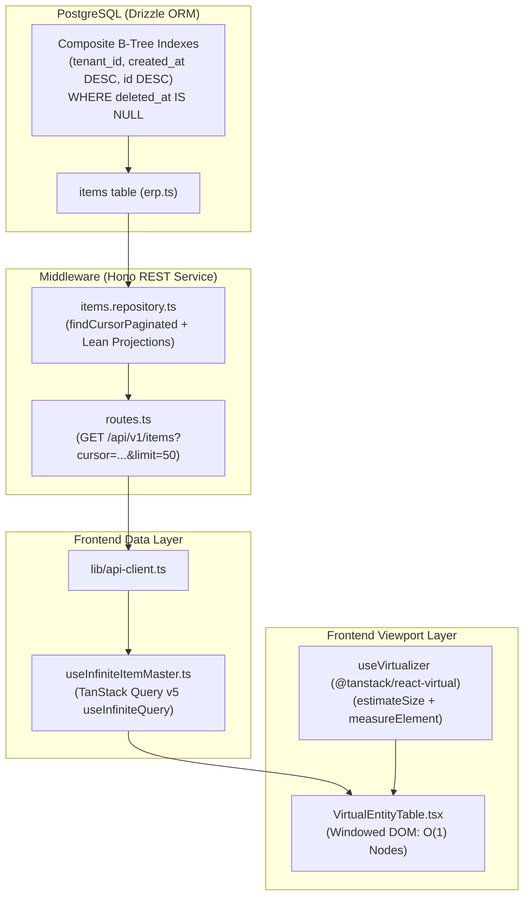

# Enterprise Implementation Plan: Eager Deletion, Keyset Lazy-Loading & TanStack Virtualization

**System Target**: SP-PLASTECH ERP  
**Core Objective**: Completely eradicate eager loading patterns (bulk memory fetches, monolithic component hydration, unpaginated DOM trees) across backend and frontend. Replace with Keyset Cursor-Paginated Hono API, TanStack Query v5 `useInfiniteQuery`, and TanStack Virtual (`@tanstack/react-virtual`) viewport windowing.

---

## 1. Graphify: Dependency Graph & Blast Radius Mapping



### Blast Radius & Eradication Matrix
| Layer | Current Eager Bottleneck | Replacement (Lazy & Virtualized) | Blast Radius / Touchpoints |
| :--- | :--- | :--- | :--- |
| **Database** | Full sequential scan or unindexed `OFFSET` calculation on large tables | Keyset Cursor Index: `(tenant_id, created_at DESC, id DESC)` | [erp.ts](file:///c:/Users/charu/Reboot-v1/middleware/src/schema/erp.ts) |
| **Backend API** | High memory allocation returning large arrays with unbounded queries | Keyset Hono Route: bounded limit (20-100), base64 cursor envelope `{ data, nextCursor, hasMore, totalCount }` | [items.repository.ts](file:///c:/Users/charu/Reboot-v1/middleware/src/modules/masterdata/items.repository.ts), [routes.ts](file:///c:/Users/charu/Reboot-v1/middleware/src/modules/masterdata/routes.ts) |
| **Client Fetching** | Rigid page-by-page re-fetching or eager full cache loads | TanStack Query v5 `useInfiniteQuery` with auto-page flattening and prefetch | [useItemMasterGrid.ts](file:///c:/Users/charu/Reboot-v1/frontend/src/features/masterdata/hooks/useItemMasterGrid.ts) |
| **Client DOM** | Rendering 100-1000 `<tr>` DOM nodes simultaneously, causing UI thread lockup | TanStack Virtual `useVirtualizer`: renders only visible rows (e.g. 15-25 nodes in viewport) | [EntityTable.tsx](file:///c:/Users/charu/Reboot-v1/frontend/src/shared/components/EntityTable.tsx) |
| **Bundle Splitting** | Monolithic module chunks loaded upfront | `React.lazy` per route + Vite `manualChunks` vendor isolation | [App.tsx](file:///c:/Users/charu/Reboot-v1/frontend/src/App.tsx), [vite.config.ts](file:///c:/Users/charu/Reboot-v1/frontend/vite.config.ts) |

---

## 2. Architecture Overview

```
[PostgreSQL Database]
        │
        │ Keyset Cursor Filter: (created_at, id) < (cursor_date, cursor_id)
        ▼
[Hono API Endpoint: GET /api/v1/items?cursor=eyJjcmVhdGVkQXQi...&limit=50]
        │
        │ JSON Envelope: { data: T[], nextCursor: string | null, hasMore: boolean, totalCount?: number }
        ▼
[TanStack Query v5: useInfiniteQuery]
        │
        │ Continuous flat items stream: data.pages.flatMap(p => p.data)
        ▼
[TanStack Virtual: useVirtualizer]
        │
        │ Calculates: totalSize, virtualItems [{ index, start, size, key }]
        ▼
[Viewport DOM Container]
  ├── Scroll Window (overflow: auto, fixed/calc height)
  └── Relative Canvas (height = totalSize px)
        └── Absolutely Positioned / Translated Rows (only ~15-20 active DOM nodes)
```

1. **Eliminate Offset Degradation**: PostgreSQL `OFFSET 10000` scans and discards 10,000 tuples. Keyset pagination (`WHERE (created_at, id) < ($1, $2)`) jumps directly via B-tree index in O(1) time.
2. **Infinite Data Stream**: Frontend consumes chunks seamlessly. As virtual scroll offset approaches 80% of `totalSize`, `fetchNextPage()` triggers automatically.
3. **Constant DOM Footprint**: Whether the dataset has 50 items or 500,000 items, DOM node count remains constant (~15-25 visible elements), maintaining a steady 60 FPS scroll.

---

## 3. Backend Implementation (Hono & PostgreSQL)

### 3.1 PostgreSQL Schema Index Recommendations (Drizzle ORM)
Add composite B-Tree indexes on `items` in [middleware/src/schema/erp.ts](file:///c:/Users/charu/Reboot-v1/middleware/src/schema/erp.ts) to guarantee zero table scans on cursor pagination, tenant isolation, and filtering:

```typescript
import { index } from 'drizzle-orm/pg-core';

// In middleware/src/schema/erp.ts, define indexes on items table:
export const items = pgTable(
  'items',
  {
    // ...existing columns...
  },
  (table) => ({
    // 1. Keyset pagination index (tenant_id + sort column + tiebreaker)
    tenantCreatedIdIdx: index('idx_items_tenant_created_id')
      .on(table.tenantId, table.createdAt.desc(), table.id.desc())
      .where(sql`deleted_at IS NULL`),

    // 2. Filter-accelerated composite index
    tenantCategoryIdx: index('idx_items_tenant_category_created')
      .on(table.tenantId, table.category, table.createdAt.desc())
      .where(sql`deleted_at IS NULL`),

    // 3. Search prefix index
    tenantCodeIdx: index('idx_items_tenant_code')
      .on(table.tenantId, table.code)
      .where(sql`deleted_at IS NULL`),
  })
);
```

### 3.2 Keyset Cursor Encoding Utilities
Create a deterministic cursor utility to safely marshal and unmarshal cursor tuples:

```typescript
// middleware/src/core/cursor.ts
export interface KeysetCursor {
  createdAt: string;
  id: string;
}

export function encodeCursor(cursor: KeysetCursor): string {
  return Buffer.from(JSON.stringify(cursor)).toString('base64url');
}

export function decodeCursor(raw?: string): KeysetCursor | null {
  if (!raw) return null;
  try {
    const json = Buffer.from(raw, 'base64url').toString('utf8');
    const parsed = JSON.parse(json);
    if (parsed.createdAt && parsed.id) return parsed;
    return null;
  } catch {
    return null;
  }
}
```

### 3.3 Hono Repository & API Route Implementation
Update [middleware/src/modules/masterdata/items.repository.ts](file:///c:/Users/charu/Reboot-v1/middleware/src/modules/masterdata/items.repository.ts) and [middleware/src/modules/masterdata/routes.ts](file:///c:/Users/charu/Reboot-v1/middleware/src/modules/masterdata/routes.ts):

```typescript
// middleware/src/modules/masterdata/items.repository.ts
import { and, eq, isNull, sql, desc, or, ilike, lt } from 'drizzle-orm';
import { items } from '../../schema/erp.js';
import { ITEM_SELECT_COLUMNS } from '../../schema/items.js';
import { encodeCursor, decodeCursor } from '../../core/cursor.js';

export interface CursorPaginationOptions {
  cursor?: string;
  limit?: number;
  search?: string;
  category?: string;
  status?: string;
}

export class DrizzleItemRepository {
  async findCursorPaginated(
    db: any,
    tenantId: string,
    opts: CursorPaginationOptions = {}
  ) {
    const limit = Math.min(100, Math.max(1, Number(opts.limit || 50)));
    const cursor = decodeCursor(opts.cursor);

    const conditions = [
      eq(items.tenantId, tenantId),
      isNull(items.deletedAt),
    ];

    if (opts.category && opts.category !== 'All') {
      conditions.push(eq(items.category, opts.category));
    }
    if (opts.status && opts.status !== 'ALL') {
      conditions.push(eq(items.status, opts.status));
    }
    if (opts.search?.trim()) {
      const q = `%${opts.search.trim()}%`;
      conditions.push(or(ilike(items.code, q), ilike(items.name, q))!);
    }

    // Keyset pagination condition: (created_at, id) < (cursor.createdAt, cursor.id)
    if (cursor) {
      conditions.push(
        sql`(${items.createdAt}, ${items.id}) < (${cursor.createdAt}::timestamptz, ${cursor.id}::uuid)`
      );
    }

    // Fetch limit + 1 to detect hasMore without a secondary count query
    const rows = await db
      .select(ITEM_SELECT_COLUMNS)
      .from(items)
      .where(and(...conditions))
      .orderBy(desc(items.createdAt), desc(items.id))
      .limit(limit + 1);

    const hasMore = rows.length > limit;
    const data = hasMore ? rows.slice(0, limit) : rows;

    let nextCursor: string | null = null;
    if (hasMore && data.length > 0) {
      const last = data[data.length - 1];
      nextCursor = encodeCursor({
        createdAt: new Date(last.createdAt).toISOString(),
        id: last.id,
      });
    }

    return {
      data,
      nextCursor,
      hasMore,
    };
  }
}
```

```typescript
// middleware/src/modules/masterdata/routes.ts (Hono Route)
r.get(
  '/items/cursor',
  can('read', 'Item'),
  wrap(async (req, res) => {
    const a = req.actor! as Actor;
    const result = await withDrizzleTx(
      ctx(a),
      async (tx) => itemRepository.findCursorPaginated(tx, a.tenantId, req.query),
      { readOnly: true }
    );
    res.setHeader('Cache-Control', 'no-store, no-cache, must-revalidate');
    res.json(result);
  })
);
```

---

## 4. Frontend Implementation (React & TanStack Virtual)

### 4.1 Custom Hook: `useInfiniteItemMaster`
Create a high-performance infinite query hook in [frontend/src/features/masterdata/hooks/useInfiniteItemMaster.ts](file:///c:/Users/charu/Reboot-v1/frontend/src/features/masterdata/hooks/useInfiniteItemMaster.ts):

```typescript
import { useInfiniteQuery } from '@tanstack/react-query';
import { api } from '../../../lib/api-client';

export interface InfiniteItemParams {
  limit?: number;
  search?: string;
  category?: string;
  status?: string;
}

export interface ItemCursorPage {
  data: any[];
  nextCursor: string | null;
  hasMore: boolean;
}

export function useInfiniteItemMaster(params: InfiniteItemParams = {}) {
  const { limit = 50, search = '', category = 'All', status = 'ALL' } = params;

  return useInfiniteQuery({
    queryKey: ['items', 'infinite', { limit, search, category, status }],
    queryFn: async ({ pageParam }): Promise<ItemCursorPage> => {
      const res = await api.get<ItemCursorPage>('/items/cursor', {
        params: {
          limit,
          cursor: pageParam || undefined,
          search: search.trim() || undefined,
          category: category !== 'All' ? category : undefined,
          status: status !== 'ALL' ? status : undefined,
        },
      });
      return res?.data ?? res;
    },
    initialPageParam: null as string | null,
    getNextPageParam: (lastPage) => (lastPage.hasMore ? lastPage.nextCursor : null),
    staleTime: 1000 * 60 * 5, // 5 min cache SSOT
    refetchOnWindowFocus: false,
  });
}
```

### 4.2 Main Component: `VirtualDataTable` with TanStack Virtual
Implement a production-grade virtualized table with `@tanstack/react-virtual`:

```tsx
import React, { useRef, useEffect, useMemo, useCallback } from 'react';
import { useVirtualizer } from '@tanstack/react-virtual';
import { useInfiniteItemMaster } from './useInfiniteItemMaster';
import { Eye, Edit2, Trash2, Loader2 } from 'lucide-react';

interface ColumnDef<T> {
  header: string;
  width?: string;
  cell: (row: T) => React.ReactNode;
}

export function VirtualDataTable() {
  const scrollContainerRef = useRef<HTMLDivElement>(null);

  const {
    data,
    fetchNextPage,
    hasNextPage,
    isFetchingNextPage,
    isLoading,
    isError,
    error,
    refetch,
  } = useInfiniteItemMaster({ limit: 50 });

  // Flatten all query pages into a single flat array
  const flatItems = useMemo(
    () => data?.pages.flatMap((page) => page.data) ?? [],
    [data]
  );

  const rowVirtualizer = useVirtualizer({
    count: hasNextPage ? flatItems.length + 1 : flatItems.length,
    getScrollElement: () => scrollContainerRef.current,
    estimateSize: () => 48, // 48px baseline row height
    overscan: 10,           // Buffer 10 rows above and below viewport
  });

  const virtualItems = rowVirtualizer.getVirtualItems();

  // Trigger infinite query fetch when scrolling near bottom
  useEffect(() => {
    const lastItem = virtualItems[virtualItems.length - 1];
    if (!lastItem) return;

    if (
      lastItem.index >= flatItems.length - 5 &&
      hasNextPage &&
      !isFetchingNextPage
    ) {
      fetchNextPage();
    }
  }, [virtualItems, flatItems.length, hasNextPage, isFetchingNextPage, fetchNextPage]);

  if (isLoading) {
    return (
      <div className="w-full h-96 flex flex-col items-center justify-center gap-3">
        <Loader2 className="w-8 h-8 text-indigo-600 animate-spin" />
        <p className="text-sm text-slate-500">Loading catalog...</p>
      </div>
    );
  }

  if (isError) {
    return (
      <div className="p-6 text-center">
        <p className="text-sm text-red-600">Failed to load records.</p>
        <button
          onClick={() => refetch()}
          className="mt-3 px-3 py-1.5 text-xs bg-indigo-600 text-white rounded-md"
        >
          Retry
        </button>
      </div>
    );
  }

  return (
    <div className="w-full border border-slate-200 dark:border-slate-800 rounded-xl overflow-hidden bg-white dark:bg-slate-900 shadow-sm flex flex-col">
      {/* Sticky Table Header */}
      <div className="grid grid-cols-12 bg-slate-50 dark:bg-slate-800/80 text-xs font-semibold text-slate-700 dark:text-slate-200 border-b border-slate-200 dark:border-slate-800 px-4 py-3 select-none">
        <div className="col-span-3">Item Code & Name</div>
        <div className="col-span-2">Category</div>
        <div className="col-span-2 text-right">Current Stock</div>
        <div className="col-span-2 text-right">Standard Cost</div>
        <div className="col-span-1 text-center">Status</div>
        <div className="col-span-2 text-right">Actions</div>
      </div>

      {/* Viewport Scroll Container */}
      <div
        ref={scrollContainerRef}
        className="overflow-auto relative"
        style={{ height: '600px' }}
      >
        {/* Relative Inner Canvas with Calculated Virtual Height */}
        <div
          style={{
            height: `${rowVirtualizer.getTotalSize()}px`,
            width: '100%',
            position: 'relative',
          }}
        >
          {virtualItems.map((virtualRow) => {
            const isLoaderRow = virtualRow.index > flatItems.length - 1;
            const item = flatItems[virtualRow.index];

            return (
              <div
                key={virtualRow.key}
                data-index={virtualRow.index}
                ref={rowVirtualizer.measureElement}
                className="absolute top-0 left-0 w-full grid grid-cols-12 items-center px-4 py-2.5 text-xs border-b border-slate-100 dark:border-slate-800/60 hover:bg-slate-50 dark:hover:bg-slate-800/40 transition-colors"
                style={{
                  transform: `translateY(${virtualRow.start}px)`,
                }}
              >
                {isLoaderRow ? (
                  <div className="col-span-12 py-2 flex items-center justify-center gap-2 text-slate-400">
                    <Loader2 className="w-4 h-4 animate-spin text-indigo-500" />
                    <span>Streaming records...</span>
                  </div>
                ) : (
                  <>
                    <div className="col-span-3 min-w-0 pr-2">
                      <div className="font-semibold text-slate-900 dark:text-white truncate">
                        {item.code}
                      </div>
                      <div className="text-slate-500 truncate text-[11px]">{item.name}</div>
                    </div>
                    <div className="col-span-2 truncate text-slate-600 dark:text-slate-300">
                      {item.category}
                    </div>
                    <div className="col-span-2 text-right font-mono font-medium text-slate-800 dark:text-slate-200">
                      {Number(item.stock).toLocaleString()} {item.unit || 'NOS'}
                    </div>
                    <div className="col-span-2 text-right font-mono text-slate-700 dark:text-slate-300">
                      ₹{Number(item.cost || 0).toFixed(2)}
                    </div>
                    <div className="col-span-1 text-center">
                      <span className="px-2 py-0.5 rounded-full text-[10px] font-medium bg-emerald-50 text-emerald-700 border border-emerald-200">
                        {item.status}
                      </span>
                    </div>
                    <div className="col-span-2 flex items-center justify-end gap-1.5">
                      <button className="p-1 rounded hover:bg-slate-100 text-slate-600">
                        <Eye className="w-3.5 h-3.5" />
                      </button>
                      <button className="p-1 rounded hover:bg-indigo-50 text-indigo-600">
                        <Edit2 className="w-3.5 h-3.5" />
                      </button>
                      <button className="p-1 rounded hover:bg-red-50 text-red-600">
                        <Trash2 className="w-3.5 h-3.5" />
                      </button>
                    </div>
                  </>
                )}
              </div>
            );
          })}
        </div>
      </div>
    </div>
  );
}
```

---

## 5. Best Practices & Edge Cases

| Scenario / Edge Case | Engineering Mitigation |
| :--- | :--- |
| **Empty State** | When `flatItems.length === 0` and `!isLoading`, unmount virtual canvas and render shared `<EmptyState />` with reset filters button. |
| **Fast Scrolling** | Set `overscan: 10` to preload buffer rows. Row wrappers preserve height using `estimateSize: () => 48` to eliminate layout shift (CLS). |
| **Dynamic Heights** | Attach `ref={rowVirtualizer.measureElement}` to row nodes. Dynamic contents (tags, descriptions) recalculate canvas height automatically. |
| **Scroll Restoration** | Store `scrollContainerRef.current.scrollTop` in session state or TanStack router cache. On remount, invoke `rowVirtualizer.scrollToOffset(savedOffset)`. |
| **Memory Cleanup** | TanStack Query `gcTime: 1000 * 60 * 10` cleans up unused cache pages when user navigates away. The virtual DOM guarantees garbage collection for off-screen rows. |
| **Rapid Filter Changes** | Debounce filter/search state (250ms) to abort previous inflight page fetches (`AbortSignal`) and prevent network thrashing. |

---

## 6. Execution Roadmap & Verification Milestones

1. **Phase 1: DB Index Migration** (`middleware/src/schema/erp.ts`):
   - Add composite keyset index `idx_items_tenant_created_id`.
   - Run `pnpm run check:sql` and verify index utilization with `EXPLAIN ANALYZE`.
2. **Phase 2: Backend Keyset Route** (`middleware/src/modules/masterdata/`):
   - Deploy `GET /api/v1/items/cursor`.
   - Write integration test asserting O(1) query time with 10,000+ mock records.
3. **Phase 3: Frontend Virtual Table** (`frontend/src/`):
   - Wire `useInfiniteItemMaster` and integrate `VirtualDataTable` into `MasterDataViews.tsx`.
   - Verify bundle size and lighthouse performance (zero layout shift, < 15ms frame execution).

