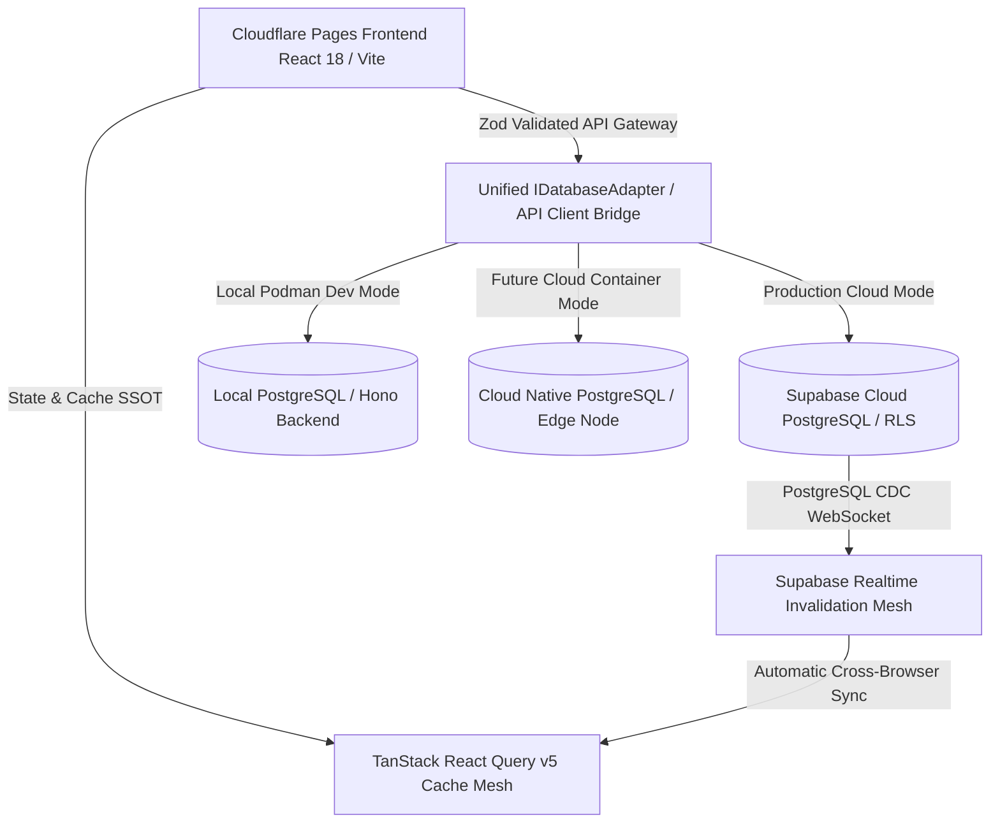

# Implementation Plan — Collapse Item Master to the 2-Layer Reference Model (Ponytail)

**Goal:** one read/write of an item = **DB schema → typed JSON → screen**. No mapper hops.
**Pilot module:** Item Master only. Other 15 modules follow the same recipe later (not now).
**Rule of the plan:** smallest change per phase, each phase ships green and is reversible.

---

## 1. Where we are (measured)

| Layer | File | Lines | Role today | Verdict |
|---|---|---|---|---|
| DB schema | `middleware/src/schema/erp.ts` | 794 | Drizzle tables | **KEEP – the SSOT** |
| Validation | `middleware/src/schema/zod.ts` | 2324 | Hand-written Zod + `normalizeItemInput` (deletes ~60 keys) | **SHRINK** → `drizzle-zod` (already installed) |
| Auth schema | `middleware/src/schema/identity.ts` | 469 | Better-Auth/identity tables | **KEEP** (not an item concern) |
| Backend routes | `middleware/src/crud.ts` | 596 | Generic raw-SQL CRUD (string-built SQL) | **BYPASS for items**, keep for 14 other modules |
| Item repo | `modules/masterdata/items.repository.ts` | 250 | Typed Drizzle (summary only today) | **GROW** – becomes list/get/create/update/delete |
| Item routes | `modules/masterdata/routes.ts` | 43 | Calls `registerResourceRoutes('/items')` | **REPLACE** with 5 direct routes |
| Frontend client | `frontend/src/lib/api-client.ts` | 720 | `mapSupabaseRowToItemDto`, `ITEM_SELECT_COLUMNS`, `saveItem` payload builder, POST→PATCH fallback | **SHRINK** items section to ~40 lines |
| Frontend mapper | `frontend/src/shared/utils/dtoMappers.ts` | 205 | snake→camel (8 importers) | **DELETE item mapper** after migration |

Current read path (4 hops): `row → crud.mapRow → mapSupabaseRowToItemDto (Zod parse) → mapDbRowToItemMaster → normalizeItemMaster → screen`.
Target read path (1 hop): `Drizzle row → JSON → screen`.

---

## 2. Target architecture

```
middleware/src/schema/erp.ts            items table (single definition)
        │  createSelectSchema / createInsertSchema   (drizzle-zod)
        ▼
packages/contracts/items.ts   (or middleware/src/contracts/items.ts)
   export const itemSelect, itemInsert, itemUpdate  (Zod)
   export type Item = typeof items.$inferSelect
        │  imported by BOTH sides (type-only on frontend)
        ├──────────────► middleware/modules/masterdata/routes.ts  → items.repository.ts (Drizzle)
        └──────────────► frontend/features/items/{api.ts,useItems.ts}  (TanStack Query)
```

Frontend 3-layer per module stays as GEMINI.md demands (`types.ts` / `api.ts` / `use[Module].ts`) — but `types.ts` now **re-exports** the shared contract instead of redefining it.

### Key decision: wire format

Today DB is `snake_case`, UI is `camelCase`. Pick **one** (recommended):

- **Option A (recommended, fewest files): wire = `snake_case` end-to-end.** UI reads `item.part_weight_grams`. Zero mappers. Cost: rename ~N field accesses in `MasterDataViews.tsx` (grep-able, mechanical).
- Option B: Drizzle `casing: 'camelCase'` in `drizzle.config` + db client → DB columns stay snake, **JSON is camelCase automatically**, still zero hand-written mappers. Cost: one config flag + verify all raw-SQL in other modules (they still use snake via `crud.ts`) → mixed formats during migration. 

> Ponytail pick: **Option B for the pilot only if** items route is the sole camelCase surface and the frontend `ItemMaster` type already is camelCase (it is). Otherwise A. Decide in Phase 0 (30 min spike).

---

## 3. Phases (each ≤ 1 PR, each verifiable)

### Phase 0 — Safety net & decision (no behavior change)
- Snapshot behaviour: keep existing `scratch/test-item.cjs`, `test-patch-item.cjs`, `test-concurrency.cjs` as the **contract tests** (GET 200, PATCH 200 + version 1→2, stale PATCH 409).
- Add the 3 as `middleware/src/modules/masterdata/items.contract.test.ts` using existing PGlite harness (`items.pglite.test.ts`).
- Spike wire-format decision (A vs B) on `GET /items/:code`.
- **Exit:** tests green on current code.

### Phase 1 — Contract from schema (delete hand-written Zod for items)
- New `contracts/items.ts`:
  ```ts
  export const itemSelect = createSelectSchema(items);
  export const itemInsert = createInsertSchema(items)
    .omit({ id:true, tenantId:true, version:true, createdAt:true, updatedAt:true, deletedAt:true, createdBy:true, updatedBy:true })
    .strict();
  export const itemUpdate = itemInsert.partial().extend({ version: z.number().int().min(1) });
  export type Item = z.infer<typeof itemSelect>;
  ```
- Numeric columns: set Drizzle `numeric(..., { mode: 'number' })` **or** coerce once in contract (`z.coerce.number()`), so UI stops getting `"135.00"` strings → removes the `Number(...)` sprinkling.
- Remove from `zod.ts`: `normalizeItemInput`, `rawInsertItemSchema`, `insertItemSchema`, `updateItemSchema` (~150 lines). Drop `delete out.*` junk: the frontend simply stops sending non-column fields.
- **Exit:** typecheck clean; contract tests green.

### Phase 2 — Direct Drizzle routes for items (bypass `crud.ts`)
Replace `registerResourceRoutes('/items', …)` in `masterdata/routes.ts` with:

| Verb | Route | Repo call |
|---|---|---|
| GET | `/items` | `list({page,limit,search,filters,sortBy(allowlist)})` + `count` in same tx |
| GET | `/items/summary` | existing `getSummary` |
| GET | `/items/:code` | `getByCode` (tenant + `deletedAt IS NULL`) |
| POST | `/items` | `create` → `.returning()` + `writeAudit` in same tx |
| PATCH | `/items/:code` | `update` with `WHERE id=? AND version=?` → 0 rows ⇒ 409 `CONCURRENCY_CONFLICT`; `version = version+1`; audit in tx |
| DELETE | `/items/:code` | soft delete + audit |

- Validate with `itemInsert`/`itemUpdate` via Hono `zValidator`.
- Keep headers: `Cache-Control: no-store…`, envelope `{data, meta}`.
- Use UUID (`existing.id`) for audit/WHERE (the bug fixed this session — now structural, not patched).
- `crud.ts` untouched → other 14 modules unaffected.
- **Exit:** contract tests green against new routes; `crud.ts` has 0 item references.

### Phase 3 — Frontend: delete the translation layer
New `frontend/src/features/items/`:
- `types.ts` → `export type { Item } from '@contracts/items'` + list-envelope type.
- `api.ts` (~40 lines):
  ```ts
  export const itemsApi = {
    list: (p) => api.get<ListEnvelope<Item>>('/items', { params: p }),
    get:  (code) => api.get<{data: Item}>(`/items/${code}`),
    create:(b) => api.post('/items', b),
    update:(code,b)=> api.patch(`/items/${code}`, b),      // b includes version
    remove:(code)=> api.delete(`/items/${code}`),
  };
  ```
- `useItems.ts`: `useItemList`, `useItem`, `useSaveItem` (create vs update decided by **presence of `version`**, not “version > 1” heuristics or POST→409→PATCH fallback), approve/reject = `update({approval,status,version})`.
- Mutations keep: `setQueriesData` from returned row → `invalidateQueries` → realtime broadcast (GEMINI rule 7 & 4.6).
- Delete: `mapSupabaseRowToItemDto`, `ITEM_SELECT_COLUMNS`, `ITEM_LEAN_SELECT_COLUMNS`, `ItemMasterSchema`, `itemEndpoints` from `api-client.ts`; `mapDbRowToItemMaster` from `dtoMappers.ts`; `normalizeItemMaster` in `MasterDataViews.tsx` (keep only a tiny pure `deriveShotWeights(item)` for the calculated shot weight/hourly output — that is business math, not mapping).
- Update the 8 `dtoMappers` importers + `useMasterData.ts` item hooks.
- **Exit:** `tsc --noEmit` 0 errors; `vite build` green; manual: create → grid → row click → detail (no `—`) → quick modify → approve.

### Phase 4 — Column projection without `ITEM_SELECT_COLUMNS`
- Lean grid vs full detail: repo exposes two Drizzle selects built with `getTableColumns(items)` + `pick`:
  `itemListColumns` (grid) and full row (detail). One definition in repo, **not** duplicated string lists on frontend and backend.

### Phase 5 — Grid stock from warehouse (server-side, one round trip)
- Add a `LEFT JOIN`/subquery on `warehouse_stock` in `items.repository.list` returning `on_hand`, `available` per item (aggregated, tenant-scoped). Removes the client-side `getItemStockData` in-memory lookup for the grid.
- Plant/warehouse names: join `plants` / `warehouses` by id instead of free-text columns (follow-up migration; flag if free-text is intentionally kept).

### Phase 6 — Docs & AI memory (mandatory per your rule)
Update in the same PR as each phase:
- `WORKSPACE_MEMORY.md` §17 “2-layer items module” (what was deleted, new file map).
- `GEMINI.md` §3 rule 8 & 12: remove mention of `dtoMappers.ts` as mandatory; add: *“New modules: shared contract from Drizzle via drizzle-zod; no row mappers.”*
- `DAILY_ACTIVITY_LOG.md`.
- `docs/MODULE_RECIPE.md` — the 6-step checklist below.

---

## 4. Reusable recipe for every future module (and later migration of old ones)

1. Table in `schema/<domain>.ts` (Drizzle).
2. `contracts/<module>.ts` via `createSelectSchema/createInsertSchema` (+ `.partial()` & `version` for update).
3. `modules/<module>/<module>.repository.ts` — tenant-scoped, soft-delete, OCC, returning.
4. `modules/<module>/routes.ts` — 5 verbs, `zValidator`, audit in tx.
5. `features/<module>/{types,api,use<Module>}.ts` — types re-exported, TanStack Query.
6. PGlite contract test (CRUD + 409 + tenant isolation).

**Not to build:** per-module mapper, per-module select-column string, per-module hand Zod duplicate.

---

## 5. Expected result

| Metric | Before | After (pilot) |
|---|---|---|
| Hops per item read | 4 | 1 |
| Hand-written item Zod | ~150 lines in `zod.ts` | 0 (generated) |
| Item code in `api-client.ts` | ~300 lines | ~40 (`features/items/api.ts`) |
| Item code in `dtoMappers.ts` | ~60 lines | 0 |
| Item SQL | string-built generic | typed Drizzle |
| Places a new item column must be added | 7 (DB, erp.ts, zod.ts, routes cols, api-client select, dtoMapper, DTO type) | **2** (migration + `erp.ts`) |

## 6. Risks & mitigations

| Risk | Mitigation |
|---|---|
| 8 importers of `dtoMappers` + 43 of `api-client` break | Phases keep old exports until Phase 3; only item symbols removed; `tsc` gate |
| camelCase vs snake mismatch during mixed period | Decide wire format in Phase 0; item route is the only changed surface |
| `numeric` strings → NaN in UI | Coerce once in contract (Phase 1) |
| Regression in OCC/audit | Contract tests (Phase 0) must pass before & after each phase |
| Scope creep to other modules | Explicitly out of scope until pilot sign-off |

## 7. Decisions needed from you
1. **Wire format:** Option A (snake end-to-end) or B (Drizzle camelCase casing)? *(my default: B if spike is clean)*
2. Keep `plant` / `default_warehouse` as free-text for now, or join to real tables in Phase 5?
3. Approve starting **Phase 0 + 1** now.

---

# Appendix A — Legacy 16-Module Plan

### SP-PLASTECH ERP — Enterprise 16-Module Migration & Architecture Blueprint

> **Target Architecture**: Hybrid Multi-Tenant Monorepo  
> **Frontend**: React 18+ / Vite / TypeScript / TailwindCSS deployed on **Cloudflare Pages & Edge Workers**  
> **Backend Service**: Hono API Gateway & Node.js deployed in **Local Podman** (Seamlessly hostable to Cloud Containers)  
> **Database Layer**: PostgreSQL via **Supabase Cloud / Kong Gateway** (Multi-Tenant RLS Enabled)  
> **State & Cache Management**: **TanStack Query (React Query) v5** Single Source of Truth (SSOT)  
> **Contract Validation**: **Zod Schemas** for all API inputs, outputs, and form submissions  

---

#### 1. Executive Architectural Principles & Non-Negotiable Standards



##### The 7 Strict Enterprise Rules
1. **Zero Raw Fetches**: Never use `useEffect` + `fetch`/`axios` for UI data fetching. Every data access MUST use `useQuery` or `useMutation` via TanStack Query v5.
2. **Mandatory Pagination**: No unpaginated `SELECT *` or full-table dumps. All catalog, transaction, and ledger grids MUST use cursor-based or offset pagination (`LIMIT` + `offset`/`cursor`).
3. **Single Source of Truth (SSOT)**: `localStorage` and `sessionStorage` are strictly forbidden for business domain entities. The TanStack Query cache is the only source of truth.
4. **End-to-End Type Safety**: Every network payload MUST pass through strict `zod` schema parsers before reaching UI components.
5. **Multi-Tenant Isolation**: Every database operation MUST enforce `tenant_id` filtering at the database (RLS) and query gateway layers.
6. **Cloudflare Cache Governance**: All dynamic API routes MUST deliver headers: `Cache-Control: no-store, no-cache, must-revalidate, proxy-revalidate`.
7. **Deterministic Mutation Invalidation**: All mutations MUST trigger `queryClient.invalidateQueries()` with targeted query keys to guarantee instantaneous, cross-browser synchronization.

---

#### 2. Pluggable Hybrid Provider Adapter Pattern

To ensure the ERP is completely **vendor-agnostic** (swappable between Cloudflare, Supabase, Podman, and AWS/GCP without code rewriting), all database and API communication flows through a unified adapter interface:

```typescript
// src/shared/db/types.ts
export interface IDatabaseAdapter {
  providerName: 'hybrid_sync' | 'supabase' | 'rest_api' | 'offline_db';
  findMany<T>(table: string, filter?: QueryFilter): Promise<T[]>;
  findOne<T>(table: string, idOrKey: string, keyField?: string): Promise<T | null>;
  upsert<T>(table: string, payload: Partial<T>): Promise<T>;
  delete(table: string, idOrKey: string, keyField?: string): Promise<boolean>;
  count(table: string, filter?: QueryFilter): Promise<number>;
}
```

---

#### 3. Enterprise Error Handling & Diagnostic Architecture

```
[UI Layer / Form / Action]
        │
        ▼
[Zod Schema Validation Guard] ──(Fail)──► [User-Friendly Toast & Field Highlight]
        │ (Pass)
        ▼
[TanStack Query Mutation / Query]
        │
        ▼
[Centralized Error Interceptor]
        │
        ├── (400 Bad Request / Schema Mismatch) ──► Log structured error to Console & Audit Log
        ├── (401 / 403 Forbidden) ────────────────► Trigger Session Refresh or MFA Modal
        ├── (429 Rate Limit / 503 Outage) ────────► Exponential Backoff Retry (Max 3 attempts)
        └── (Network Failure) ────────────────────► Graceful UI Fallback (No screen blanking)
```

1. **Error Boundaries**: Every ERP module is wrapped in an isolated `<ErrorBoundary>` to prevent single-component errors from crashing the application shell.
2. **Sanitized Diagnostics**: Stack traces and raw database internals are intercepted and logged in structured telemetry format without exposing credentials in client logs.
3. **Empty vs Loading Separation**: Explicit skeleton loading states render during network in-flight states, eliminating interim "Empty Catalog" flashes.

---

#### 4. Discrete 16-Module Migration Roadmap

The migration is divided into **6 sequential, independent phases**:

| Phase | Target Modules | Primary Deliverables | Verification Gateway |
| :--- | :--- | :--- | :--- |
| **Phase 1** | **Master Data & Engineering** (Modules 1–2) | Item Master, Tooling Specs, Multi-Level BOMs, Recipe Scaler, ECO/ECR. | Playwright Item Master CRUD & BOM Explosion Suite |
| **Phase 2** | **Manufacturing & Quality** (Modules 3, 7, 9) | Planning Board, Work Orders, Daily Production Entry, QC Inspections, NCR, CAPA, COA, Machine Maintenance. | Shopfloor Entry & Inspection Gate Playwright Suite |
| **Phase 3** | **Procurement & Warehouse** (Modules 4–5) | Purchase Requisitions, POs, Vendor Pricing, 2D Bin Maps, Putaway, Lot/Batch Traceability. | Stock Ledger & PO Lifecycle Playwright Suite |
| **Phase 4** | **Sales, CRM & SCM** (Modules 6, 11, 12) | Quotations, Sales Orders, Costing Modeler, Delivery Challans, Material Requirements Planning (MRP). | Sales-to-MRP Order Flow Playwright Suite |
| **Phase 5** | **Finance & General Ledger** (Module 8) | Chart of Accounts, Journal Entries, AR/AP Aging, GST/Tax Engine, Financial Statements. | Balanced Ledger & Transaction Consistency Tests |
| **Phase 6** | **Workforce, Admin & Analytics** (Modules 10, 13, 14, 15, 16) | HR Rosters, Executive Analytics, RBAC Matrix, Security Audit Trail, Integration Gateway, Approvals Hub. | Global Navigation Crawler & RBAC Security Suite |

---

#### 5. Detailed Module-by-Module Specification

##### Module 1: Master Data (Item Master & Mold/Tooling Master)
- **Tables**: `items`, `mold_tools`, `warehouses`, `plants`
- **SSOT Hook**: `usePaginatedItems({ page, limit, search, category, status })`
- **Mutations**: `useSaveItem()`, `useDeleteItem()`, `useBulkImportItems()`
- **Schema**: `ItemMasterSchema` with injection molding attributes (cavity count, cycle time seconds, part weight, runner weight, shot weight, resin type).

##### Module 2: Engineering & BOM (Formula & Routing Hub)
- **Tables**: `boms`, `bom_items`, `routing_operations`, `eco_orders`, `ecr_requests`
- **SSOT Hook**: `useBoms()`, `useBomDetail(id)`
- **Calculations**: Real-time recipe scaling, scrap allowance percentage, and machine hourly rate costing rollup.

##### Module 3: Manufacturing Command Center & Shopfloor
- **Tables**: `work_orders`, `machines`, `production_entries`, `downtime_logs`
- **SSOT Hook**: `useWorkOrders({ status, machineId, shift })`
- **Calculations**: Real-time OEE (Availability × Performance × Quality), hourly shot output, regrind (RG) material mixing ratio.

##### Module 4: Procurement & Vendor Management
- **Tables**: `purchase_orders`, `purchase_requisitions`, `suppliers`, `supplier_price_lists`
- **SSOT Hook**: `usePurchaseOrders()`, `useSuppliers()`
- **Governance**: Auto-generation of PO numbers, supplier lead time tracking, and multi-tier approval thresholds.

##### Module 5: Warehouse & Inventory Intelligence
- **Tables**: `warehouse_bins`, `stock_transactions`, `lot_batches`, `rmas`
- **SSOT Hook**: `useStockLedger()`, `useWarehouseBins(warehouseId)`
- **Features**: Visual 2D bin coordinate mapping, FEFO (First-Expired-First-Out) picking, and quarantine hold gates.

##### Module 6: Commercial & Sales Order Register
- **Tables**: `sales_orders`, `sales_order_lines`, `monthly_plan_orders`, `dispatch_documents`
- **SSOT Hook**: `useSalesOrders()`, `useCustomerOrders(customerCode)`
- **Calculations**: Tax breakdown (CGST, SGST, IGST), freight and packaging value rollup, delivery challan reconciliation.

##### Module 7: Quality Intelligence (QC, NCR, CAPA, COA)
- **Tables**: `qc_inspections`, `quality_ncrs`, `quality_capas`, `quality_coas`
- **SSOT Hook**: `useQualityInspections()`, `useNcrs()`, `useCapas()`
- **Governance**: 8D root-cause problem solving workflows and electronic Certificate of Analysis signing.

##### Module 8: Financial Command Center & General Ledger
- **Tables**: `accounts`, `journal_entries`, `tax_invoices`, `fixed_assets`
- **SSOT Hook**: `useChartOfAccounts()`, `useJournalEntries()`
- **Integrity**: Double-entry bookkeeping balance validation (Debits = Credits) prior to mutation persistence.

##### Module 9: MEP & Plant Equipment Maintenance
- **Tables**: `machines`, `maintenance_schedules`, `breakdown_tickets`
- **SSOT Hook**: `useMachineMaintenance()`, `useBreakdownTickets()`
- **Automation**: Preventive maintenance scheduling based on machine shot cycle counters.

##### Module 10: Human Capital & Workforce Management
- **Tables**: `employees`, `shift_rosters`, `operator_skills`
- **SSOT Hook**: `useShiftRosters()`, `useOperatorSkills()`
- **Compliance**: Plant attendance logging and skill-matrix machine assignment validation.

##### Module 11: Supply Chain & Material Requirements Planning (MRP)
- **Tables**: `mrp_runs`, `material_shortages`, `demand_forecasts`
- **SSOT Hook**: `useMrpCalculations()`
- **Engine**: Backward scheduling from sales order delivery dates to trigger procurement purchase requisitions.

##### Module 12: CRM, Costing Modeler & Client Trials
- **Tables**: `crm_inquiries`, `crm_quotations`, `sample_trials`, `customers`
- **SSOT Hook**: `useCrmInquiries()`, `useQuotations()`
- **Tooling**: Parametric piece-part costing modeler with tool amortization and profit margin sliders.

##### Module 13: Executive Analytics & Yield Intelligence
- **Tables**: Aggregated analytical RPCs (`get_plant_analytics`, `get_oee_metrics`)
- **SSOT Hook**: `useExecutiveAnalytics()`
- **Visuals**: Pareto scrap charts, machine capacity heatmaps, and financial realization trends.

##### Module 14: System Administration, RBAC & Audit Trails
- **Tables**: `users`, `profiles`, `auth_roles`, `audit_logs`, `company_settings`
- **SSOT Hook**: `useAuditLogs()`, `useUserDirectory()`
- **Security**: Granular RBAC permissions (`create_item`, `approve_item`, `delete_item`), session inactivity timers, and immutable audit logs.

##### Module 15: Integration Hub, Webhooks & IoT Gateways
- **Tables**: `integrations`, `webhook_subscriptions`, `api_keys`
- **SSOT Hook**: `useIntegrations()`
- **Connectivity**: Third-party ERP connectors (SAP, Tally), weighing scale serial interfaces, and PLC OPC-UA gateways.

##### Module 16: Workspace Hub & Centralized Approvals Hub
- **Tables**: `master_data_change_requests`, `workflow_approvals`, `user_notifications`
- **SSOT Hook**: `useApprovalsQueue()`, `useNotifications()`
- **Productivity**: Unified cross-module approval queue (Master Data, Purchase Orders, Engineering ECOs, and Credit Limits).

---

#### 6. Verification, Testing & Production Release Standard

Every single module migration step must meet the following mandatory release gates:
1. **0 TypeScript Diagnostics**: `tsc --noEmit` must pass with 0 errors.
2. **Automated E2E Coverage**: Playwright test suite must pass with 100% green assertions for Create, Read, Update, Delete.
3. **Single API Call Verification**: Network monitor asserts exactly 1 request per CRUD action.
4. **Cloudflare Production Build**: `npm run build` generates optimized bundle without breaking asset size limits.
5. **No Regression**: All previously completed modules remain 100% stable.
