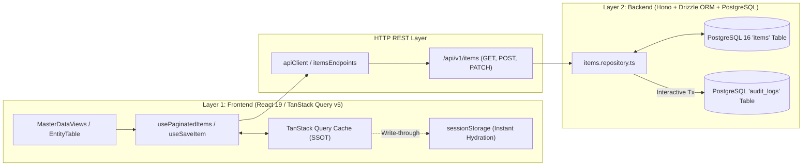

# SP-PLASTECH ERP — AI Model Rules Update & Architecture Plan

## Executive Summary
This document provides:
1. **Task-0**: Full inventory of all model-following rule files, guidelines, and skill protocols governing the AI in this project.
2. **Task-1**: Code study of the modern Item Master API architecture (Two-Layer Direct REST pattern, TanStack Query v5 cache SSOT, instant sessionStorage initial hydration, PostgreSQL metadata persistence, and bounded single-round-trip pagination).
3. **Actionable Implementation Plan**: Concrete additions and updates to [`GEMINI.md`](file:///c:/Users/charu/Reboot-v1/GEMINI.md) and [`.agents/rules/`](file:///c:/Users/charu/Reboot-v1/.agents/rules/) ensuring every agent strictly replicates this proven pattern across all 16 ERP modules without introducing regression.

---

## 1. Task-0: Complete Inventory of Model Rule Files

In this workspace, the AI model is governed by three levels of configuration:

### Level A: Root System Rules (Highest Priority)
- **[`GEMINI.md`](file:///c:/Users/charu/Reboot-v1/GEMINI.md)**
  - *Scope*: System protocols, domain definitions, tech stack constraints, enterprise rules (Rules 1–12), backend PostgreSQL + Drizzle ORM standards, OCC, session lifecycle (`/pause` and `/resume`).

### Level B: Dedicated Agent Rules (`.agents/rules/`)
- **[`.agents/rules/enterprise-memory.md`](file:///c:/Users/charu/Reboot-v1/.agents/rules/enterprise-memory.md)**
  - *Scope*: Memory persistence, architectural invariants, context compression, and state checkpoints.
- **[`.agents/rules/headroom.md`](file:///c:/Users/charu/Reboot-v1/.agents/rules/headroom.md)**
  - *Scope*: Cognitive headroom optimization, avoiding verbose repetitive tool outputs, high-signal communication.
- **[`.agents/rules/ponytail.md`](file:///c:/Users/charu/Reboot-v1/.agents/rules/ponytail.md)**
  - *Scope*: Minimal code footprint, YAGNI, anti-bloat, direct surgical edits.
- **[`.agents/rules/graphify.md`](file:///c:/Users/charu/Reboot-v1/.agents/rules/graphify.md)**
  - *Scope*: AST dependency traversal, module boundary enforcement, caller/callee contract verification before refactoring.

### Level C: Active Operational Skills (`.agents/skills/`)
- **[`.agents/skills/pause/SKILL.md`](file:///c:/Users/charu/Reboot-v1/.agents/skills/pause/SKILL.md)** & **[`.agents/skills/resume/SKILL.md`](file:///c:/Users/charu/Reboot-v1/.agents/skills/resume/SKILL.md)**: Session pause/resume execution and state rehydration.
- **[`.agents/skills/supabase-postgres-best-practices/SKILL.md`](file:///c:/Users/charu/Reboot-v1/.agents/skills/supabase-postgres-best-practices/SKILL.md)**: Database schemas, constraints, indexing, connection pooling, and multi-tenant RLS.

---

## 2. Task-1: Study of Item Master API Call Architecture

The Item Master implementation establishes the **gold standard** for all modules in SP-PLASTECH ERP:

### 2.1 The Two-Layer Architecture Pattern

### 2.2 Core Architectural Principles Learned

1. **Zero Raw Fetch & Zero Secondary Count Queries**:
   - Every fetch uses `useQuery` via [`useMasterData.ts`](file:///c:/Users/charu/Reboot-v1/frontend/apps/web/src/modules/masterdata/api/useMasterData.ts).
   - Single round-trip pagination: `includeTotal=true` returns `{ data: items[], meta: { total, totalPages } }`. No extra `/count` network request.
2. **Instant `sessionStorage` Initial Hydration (`0ms` Refresh)**:
   - To eliminate double-screen skeleton flash on browser refresh, page-1 responses write to `sessionStorage` under `sp_items_cache_p1`.
   - On refresh, `useQuery` loads `initialData: getCachedPage1Items()` with `initialDataUpdatedAt: 0`. The UI renders the table rows in **0ms** while silently validating the background network response.
3. **Pure Two-Layer Flow (Zero DTO Mappers)**:
   - Database schema fields (`items` table) flow directly into `ItemMaster` objects via [`items.repository.ts`](file:///c:/Users/charu/Reboot-v1/middleware/src/modules/masterdata/items.repository.ts) and [`api-client.ts`](file:///c:/Users/charu/Reboot-v1/frontend/src/lib/api-client.ts).
   - Legacy `mapDbRowToItemMaster` helper functions are decommissioned.
4. **Metadata Preservation & Interactive Transaction Auditing**:
   - Extended manufacturing and tooling attributes (36+ fields) are safely serialized inside `items.metadata` JSONB.
   - Every create, update, or status change automatically writes an immutable record to `audit_logs` inside the **same database transaction**.
5. **Dynamic Governance API Sync**:
   - Custom admin fields (Resin types, Item groups, BOM classes, Plants, Owners) sync to PostgreSQL via `/api/v1/master-data/options` and `masterDataGovernanceService.ts`, making user-created options available globally in dropdowns without code deployments.

---

## 3. Plan for Updating Model Rules (`GEMINI.md`)

To standardize this pattern codebase-wide, we will update [`GEMINI.md`](file:///c:/Users/charu/Reboot-v1/GEMINI.md) with three new codified clauses:

### Proposed Updates to `GEMINI.md`:
1. **Rule 8 Enhancement (Single-Round-Trip Pagination & Instant Hydration)**:
   - Mandate `includeTotal=true` with single-round-trip pagination envelopes.
   - Require `sessionStorage` fallback hydration (`initialDataUpdatedAt: 0`) for primary list screens to guarantee zero-flash browser reloads.
2. **Rule 10 Enhancement (Metadata JSONB Strategy & Transactional Audits)**:
   - For entities with extensive domain attributes, specify the canonical pattern of persisting domain metadata inside a JSONB column (`metadata` or `_meta`) while keeping primary indexed columns normalized.
   - Enforce audit log emission within the same interactive write transaction.
3. **Rule 13 (Dynamic Governance & Admin Options SSOT)**:
   - New rule: Any user-extensible dropdowns (categories, classes, plants, owners) must query the live `/api/v1/master-data/options` endpoint instead of relying on hardcoded arrays.

